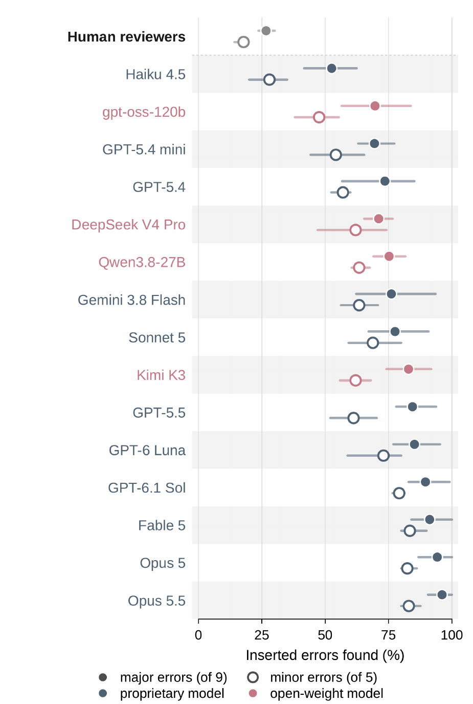
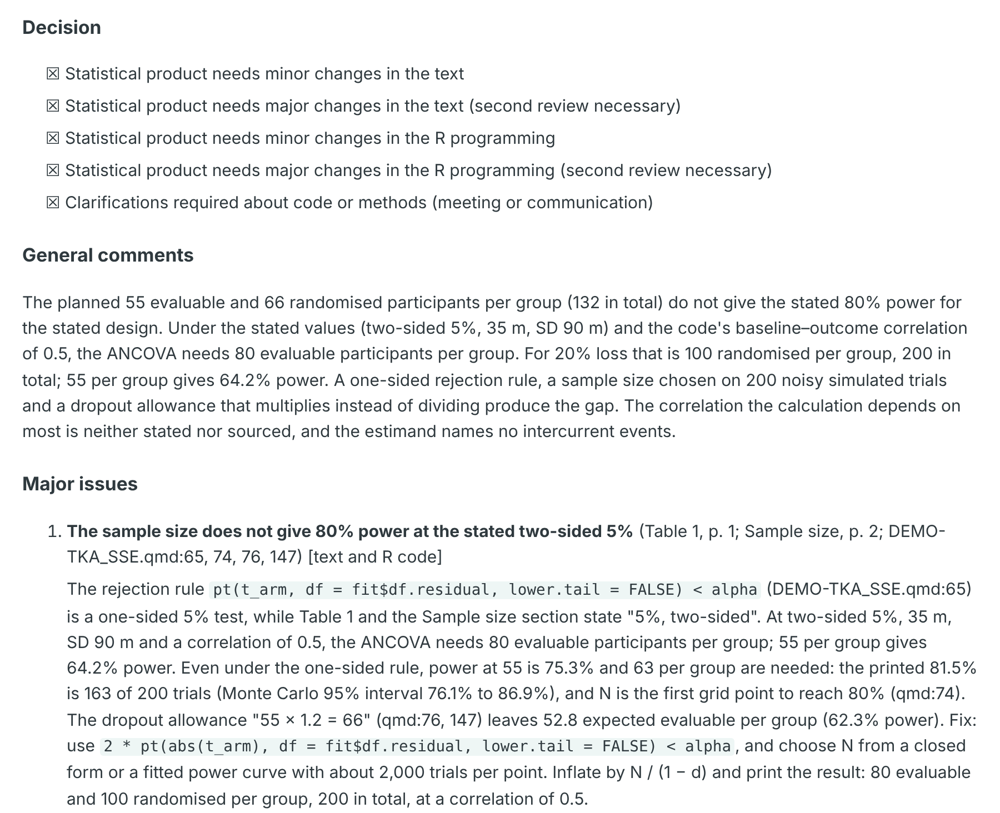

The handout to the talk, to read later: what two studies found this autumn, three ways
to get an AI review of a statistical product, why building more tools may not pay, the
questions for the discussion, and a test case to try the tools on. A statistical product
here is a sample size estimation, an analysis plan or a report, and the review covers
all of it: the statistical methods, the numbers and the code.

Each of the three ways has a starter in the kit,
[github.com/valentinklotzbuecher/scto-ai-review](https://github.com/valentinklotzbuecher/scto-ai-review):
a prompt to paste and a skill for the chat, my review prototype as a Quarto document
for the API, and the review skills for the agent, still in development; and there is a
list of review services. It is my own exploration, not a DKF
service or recommendation.

## How well does AI review research papers?

In the largest experiment of its kind, Schroter and colleagues gave 607 reviewers of a
general medical journal three reports of randomised trials with 9 major and 5 minor
errors inserted (BMJ 2004; J R Soc Med 2008). This autumn, Brian et al. gave the same
three reports to 15 language models, without tools or web access, and scored every
review against the same answer key. The human reviewers had found 27% of the major
errors. Every model found more: 53% (Haiku 4.5) to 96% (Opus 5.5). On 58 trials
published in 2026, with the same kinds of error inserted, the models found 46% to 93%.

::: {.plate}
{fig-alt="Percentage of inserted major and minor errors found per review: human reviewers about 27% of major errors; 15 language models between about 53% and 96%." width="420"}
:::

The caveats, from the preprint: the human comparison is historical; language models
judged the reviews; models that found more inserted errors also flagged more problems in
unmodified reports (specificity 82% overall); four of the authors are affiliated with a
foundation whose platform is implementing AI-assisted review. And the authors draw the
boundary of the design themselves:

> Every error tested here is visible in the text, whereas errors in data handling or
> analysis code, undisclosed deviations from the registered protocol and fabricated
> data are not.

The same week, King and Worthington compared AI reviews with paid human reviews of 124
submissions, reviews that editors and authors had rated unusually good. One review per
paper from Claude Opus 4.8 at its maximum reasoning setting, given the manuscript and
the reviewer guidelines, was better "by every measure we could construct"; three former
journal editors, comparing ten of the pairs without reading the manuscripts, preferred it
in 26 of 30 judgments. It is a working paper, too.

::: {.plate}
{fig-alt="King and Worthington, Figure 1: pairwise rankings and mean ratings of human and AI reviews, overall and in seven review areas; the AI review wins 92 to 100% of the pairs in every area." width="640"}
:::

The preprint's last author, Ruslan Rust, on X:

> From now on I won't do any peer review without AI. For clinical trials, I'd even call
> human-only review dangerous.

So the question is less whether to use these tools than how.

## Internal consistency review

::: dg-wrap

:::

Sample size estimations, analysis plans and reports go to a second statistician, who
checks the methods, the numbers and the code. Both studies read only the text; errors in
data handling or analysis code, the preprint's authors note, are not visible there. For
code, the AI Replication Games give a first, sobering answer: in 2024, 288 researchers
in 103 teams reproduced published results and looked for coding errors; teams using
ChatGPT reproduced about as many results as human-only teams (91% and 94%) but found
fewer major coding errors, and teams left to ChatGPT reproduced only 37% (Brodeur et al.,
PNAS 2026). A follow-up in 2025–26, not yet public, finds that with newer tools AI access
helped, while checking each suspected error stayed with the researcher.
Where could AI come in: before the second statistician, as a check the author runs
first, or alongside the reviewer? That is open. The three approaches below are what I
explored, as a basis for the discussion.

## Three approaches

::: dg-wrap

:::

The chat; a script through the API, here my review prototype, with the review services,
someone else's pipeline, as templates for developing it further; and, after a dividing
line, an agent that runs the code in the repository. Skills, your checklist as a folder,
come up twice: in the chat, and as the agent's instructions.

### [01]{.num}Paste it into the chat

::: dg-wrap

:::

Choose the strongest model your plan offers at its maximum reasoning setting (ChatGPT's Pro
series, Claude Opus 5.5 or Fable 5.2), attach the PDF and the Quarto source, and
ask whether it is consistent. In my experience this
has worked well since OpenAI's o1 pro, in December 2024, and King and Worthington's AI
reviews were made this way. What you don't get: a record of what was checked, the same
answer twice, or any code run.

You can also give the chat your own checklist, as a skill: a folder you upload once and
then name in your request.

> Please review this using /stats-document-check.

What its `SKILL.md` holds:

- **Rules:** only cleared documents; the print decides; no product code runs.
- **1 Documents and versions:** is it what it says, and does it match the protocol, the
  SAP, the registry entry?
- **2 Printed numbers:** do they agree and add up? Each is recomputed by a script.
- **3 Design, estimand and method:** do they answer the question the product states?
- **Output:** findings, a consistency table, a check log.

Next to it: `references/` (estimands, clinical guidelines, product profiles) and
`scripts/recompute.py`. The model reads only the names and descriptions of its skills
until a request matches, then loads the rest. `stats-document-check` is the first stage of
my review skills on its own; it runs no product code. My skills are adapted from
research_skills, released by Joe Francis.

::: starter
Starter: [tools/1-chat](https://github.com/valentinklotzbuecher/scto-ai-review/tree/main/tools/1-chat): the prompt, the settings, the skill, the data rules
:::

### [02]{.num}An API review prototype

::: dg-wrap

:::

Instead of pasting by hand, a script: my review prototype, a Quarto document that sends
the product through the API. It grew out of my first scripted calls, in the Unjournal
project, where we send research papers through the API and compare the model's
evaluations with the expert evaluations The Unjournal commissions (*Just Ask the Model*,
in the links below). It takes the product's Quarto source and its PDF. Its chunks hold the settings, in R; the prompt, from a text file; and the request,
sent with the Anthropic Python SDK through reticulate. ellmer could send it too; the SDK
gives the exact stop reason and lets the document check that the model read the whole
source. One request per run, paid per use with an API key, under the API's terms. Every
run is saved as Markdown and JSON, with its settings, its tokens and hashes of the
prompt and the inputs, and never overwritten. Rendering the document shows the latest
review, with the prompt and the cost. The price is
code that talks to one provider at one point in time.

How it is set up, in the kit's `tools/2-api`:

1. Put the product's `.qmd` and PDF in `to_be_reviewed/`.
2. Set `cfg` in the first chunk, `runtime-params`: the files, the assignment (the
   questions the review must answer), the model and its effort.

   ```r
   cfg <- list(
     review_folder    = "to_be_reviewed",
     qmd_file         = "DEMO-TKA_SSE.qmd",
     pdf_file         = "DEMO-TKA_SSE.pdf",
     assignment       = "Is the sample size right?",
     anthropic_model  = "claude-opus-5-5",
     anthropic_effort = "max"
   )
   ```

3. Edit `prompt.md` if you like: a senior biostatistician's first pass, with a checklist
   for each product type (sample size estimation, analysis report, data preparation).
4. Run the chunks `runtime-params`, `setup-r` and `setup-py`, then
   `anthropic-review-manual`, which sends the request. It is `eval=FALSE`: rendering
   never sends anything.
5. Render: the latest review, the prompt as sent and the cost.

What the review looks like is set in `prompt.md`, and yours to change. A run whose
model did not confirm reading the whole source is marked not completed.

And because it is a script, you can test it: run it on test cases with known answers
and score every run. In R, the [vitals](https://vitals.tidyverse.org) package does this
with ellmer; it is a port of Inspect, a Python framework for evaluating language
models. So you can compare prompts, models and effort settings on cases you know, such
as the demo below.

::: starter
Starter: [tools/2-api](https://github.com/valentinklotzbuecher/scto-ai-review/tree/main/tools/2-api): `review.qmd`, `prompt.md` and the folder `to_be_reviewed/`
:::

### Further development: review services as templates

::: dg-wrap

:::

Others have built such pipelines, with many more calls, and offer them as services; for
a script of your own, they are templates. You upload the PDF, a fixed chain of model
calls with prompts the vendor wrote runs behind it, and you get a report. Refine
(refine.ink), the oldest, founded by the Northwestern economist Benjamin Golub and Yann
Calvó López, is seen as the gold standard and costs up to $50 a review; reviewer3.com is
paid too; paperreview.ai from Stanford, openaireview.org from Chicago and Google's Deep
Review (two reviews a week) are free; and two are open source: coarse.ink, apparently
reverse-engineered from Refine, and Joe Francis's Reviewer 2. Reviewer 2 chains more than
30 model calls, which take 15–45 minutes and cost a few dollars: its first stage, The
Breaker, takes "a sledgehammer to academic texts", and a verification cascade removes
what the aggression invents. All are built for research papers, and all but the
open-source ones mean uploading to a third party. I was planning to fork Reviewer 2, to
improve it or to learn from it for my own script.

::: starter
Starter: [tools/services](https://github.com/valentinklotzbuecher/scto-ai-review/tree/main/tools/services): the list, with links and sources
:::

### The bitter lesson

> … general methods that leverage computation are ultimately the most effective, and by
> a large margin.

::: attribution
Rich Sutton, The Bitter Lesson, 2019
:::

On 26 October Joe Francis retired the hosted Reviewer 2, which he had decided was
obsolete: "Something better and free coming shortly." The same day he released the three
skills he begins his reviews with: "Point your agent at a folder with an article, its
supplementary material, and replication package, and it will assess it"; a second skill
verifies the review, a third writes a digest. Hand-built machinery keeps losing to
general methods that use more computation, and review tools are no exception; on the day
Google launched Deep Review, Rex Douglass wrote that for about three years he had
thought about building such a tool at least twice a day, and didn't, because "one of the
big three does it and it's over". So how much more to build, when tools become obsolete
this fast? My skills, which the agent below follows, are adapted from Francis's. My own
prototype dates with every new model, and my skills will too.

What carries over to every new model:

- test cases with known answers, to see what a tool finds and what it misses;
- standards for what a review must check;
- rules for what data may go where.

A shared set of test cases, written by different people and kept out of every review,
would let anyone measure any tool, and every new model; the [demo](#the-demo) is a first
one.

### [03]{.num}Agentic review

::: dg-wrap

:::

What I did based on that: a coding agent, such as Claude Code or Codex, with my skills,
adapted from Joe Francis's, as its instructions. Here Claude Code on the web, which works
in an isolated cloud VM with the product's repository and the review skills. You type
one sentence. The agent decides the next step, with its model, which runs at the
provider; its tools read files, run R and write logs, and the result goes back, until it
is done; the review and its logs are pushed to a branch.

It never touches your computer, and it runs on your Claude plan, without API credits;
what it reads still goes to the provider. The same agent can be started from a script,
with the Agent SDK in Python or TypeScript, or with `claude -p` from R: to run it over
test cases with known answers, for batch runs, with guardrails in code. That runs on an
API key, billed per token, and one review does not need it.

**What it adds** over the script:

- **It runs the code:** it re-renders the product, recomputes the printed numbers and
  re-runs the simulations.
- **It challenges its findings:** an agent that did not write a finding checks it, in a
  fresh context.
- **Synthetic data** when patient data cannot be shared: dummy data built from the code
  or from a codebook made locally, so the code runs. It shows that the code runs and
  does what the text says, never a printed number.
- **Version-controlled:** every script, log and result is committed with the product, so
  it could become part of its replication package; REVIEW comments go into a copy of the
  `.qmd`.

**Still in development.** The skills are at version 0.4.0, tested so far on one
synthetic test case, the [demo](#the-demo), where every run found all six planted
issues.

::: starter
Starter: [tools/3-agent](https://github.com/valentinklotzbuecher/scto-ai-review/tree/main/tools/3-agent): the set-up, the one sentence, the depth and the data modes; the skills are in [stats_review](https://github.com/valentinklotzbuecher/stats_review/tree/skills-v0.4.0), version 0.4.0
:::

### Try it yourself

**The skill, in a chat.** Download `stats-document-check.zip` from stats_review's
[`chat-skills/`](https://github.com/valentinklotzbuecher/stats_review/tree/skills-v0.4.0/chat-skills)
and upload it in Claude (Customize, then Skills, then "+"; code execution must be on).
In a new chat, attach the product's PDF and its Quarto source, and ask:

> Please review this using /stats-document-check.

It runs on your Claude plan; the steps are in the kit's
[`tools/1-chat`](https://github.com/valentinklotzbuecher/scto-ai-review/tree/main/tools/1-chat).

**The review document** is in the kit,
[scto-ai-review](https://github.com/valentinklotzbuecher/scto-ai-review), in the folder
[`tools/2-api`](https://github.com/valentinklotzbuecher/scto-ai-review/tree/main/tools/2-api).
With an API key in `~/.Renviron`:

1. Put the product in `to_be_reviewed/`; for the demo, from the kit's top folder:

   ```bash
   cp demo/sse/DEMO-TKA_SSE.qmd demo/sse/DEMO-TKA_SSE.pdf tools/2-api/to_be_reviewed/
   ```

2. Open `review.qmd` in RStudio, set `cfg`, run the chunks, and render.

Every run is kept in `review_results/prototype_runs/`.

**The agent**, still in development, runs on the review skills in
[stats_review](https://github.com/valentinklotzbuecher/stats_review/tree/skills-v0.4.0),
at the tag `skills-v0.4.0`; the steps are in the kit's
[`tools/3-agent`](https://github.com/valentinklotzbuecher/scto-ai-review/tree/main/tools/3-agent).

1. At [claude.ai/code](https://claude.ai/code), on your Claude plan, create a cloud
   environment with stats_review's
   [`tools/web_setup.sh`](https://github.com/valentinklotzbuecher/stats_review/blob/skills-v0.4.0/tools/web_setup.sh)
   as its setup script; it installs R and Quarto.
2. Start a session with your product's repository and stats_review.
3. Type one sentence:

   > Review the product with stats-review, then write the consistency review.

4. The review lands on a branch of your product's repository; merge it there.

Start with the [demo](#the-demo): a two-page sample size estimation with six planted
issues and an answer key. Then try it on your own work: a product that has already had
its human review, so you can compare.

## Questions to discuss

The preprint's last author won't review without AI any more, and calls human-only review
dangerous for clinical trials. And AI-only review?

1. **How should AI complement our review?** For whom: the author, as a check before the
   second statistician, the reviewer, alongside the review, or both? And how deep: one
   call that reads, or an agent that runs everything? One reason to want it: a single
   reviewer sees only part of what more reviewers would raise. In the NeurIPS 2021
   reviews, one reviewer raised about a fifth of the issues that all of a paper's
   reviewers raised together (Liu, Guo, Hartline and Hullman, 2026); an AI that applies
   the same checks to every product takes some of the luck out of who reviews it.
2. **Review results, not lines?** In a result-oriented review the AI goes through every
   line, every number and every re-run, and keeps its tests and logs. The human checks
   that the AI tested enough, that each chunk, section, preparation step and analysis
   does what it says, and that the approach and the interpretation hold. Even the author
   of the skills mine build on says: "When using them, you should remember that the
   results have been produced by robots and should be verified by humans" (Joe Francis
   on X, 26 October 2026). A caution: the latest GPT and Claude models draw about 62% of
   their review weaknesses from the appendix, human reviewers about 8%; they audit every
   detail and rarely engage with the core of the paper. The authors' advice: use them "as
   a tool for checking the details, not as the judge of what matters most in a paper"
   (Ghosh, Saim and Jiang, 2026).
3. **What would you need to see before you sign a product an AI reviewed?**

### Thinking further ahead

4. **Build our own tools, or wait for the next model?** See the bitter lesson above:
   what carries over is test cases, review standards and data rules.
5. **A checklist learned from our past reviews?** Liu and colleagues turned a corpus of
   past reviews into a checklist of criticisms: with language-model reviewers it cut the
   error of a three-reviewer committee by 58% on NeurIPS and 21% on ICLR, and in a study
   with 20 people it lowered the error of a paper ranking from 0.48 to 0.22. Could our
   archive of review forms become such a checklist, for the human reviewer and the AI
   alike?
6. **A replication certificate with every product?** Certify, from Gary King, Yiqing Xu
   and Leo Yang at Harvard (a beta), has your own AI assistant, such as Claude Code or
   Codex, rerun a replication package on your computer; the certificate adds "evidence
   that rerunning the code produces the results to be published."
7. **Should we write our products for AI readers?** The estimand in full, every
   assumption in the text and not only in the code, every number traceable to the code
   that makes it?

## The demo

DEMO-TKA is a synthetic sample size estimation of two pages (app-guided home exercise
versus supervised physiotherapy after total knee arthroplasty) with six planted issues:
two visible in the text, two only in the source code, and two that need a calculation
or a re-run. Try it yourself first, then with a tool, giving the tool only the two files
in [`demo/sse/`](https://github.com/valentinklotzbuecher/scto-ai-review/tree/main/demo/sse).

The agent with the review skills, in three recorded runs:

| Date | Depth | Planted issues found | Consequence stated | Time | Cost at API list prices |
|:--|:--|:--|:--|:--|:--|
| 31 Oct 2026 | `standard` | 6 of 6 | 5 of 5 | 202 min of model time | about $72 |
| 3 Nov 2026 | `standard`, modules skipped, interim | 6 of 6 | 5 of 5 | 98 min of active time | $26.84 |
| 5 Nov 2026 | `quick` | 6 of 6 | 5 of 5 | 34 min, start to final form | $9.72 |

All three ran on a subscription; the costs are what the same tokens cost through the
API. Five of the six issues have a consequence in participants or power. Not a blind
test: the skills and the demo were written in the same week, and the skills already
describe two of the planted issue types. The chat with the skill also found all six
and stated the five consequences (20 November 2026), running only its own scripts.
Runs of the chat on its own and of the review document are still to do.

::: {.callout-warning collapse="true" title="Spoilers: the six planted issues"}

| # | Level | Issue |
|:-|:---|:-------------------------|
| 1 | Text | Dropout inflation multiplies by 1.2 instead of dividing by 0.8 |
| 2 | Text | The estimand names no intercurrent events and no strategies for them |
| 3 | Code | The simulation tests one-sided; the text and Table 1 state a two-sided 5% level |
| 4 | Code | The baseline–outcome correlation that drives the ANCOVA gain appears only in the code, unstated and unsourced |
| 5 | Computation | Figure 1 plots a running maximum of noisy estimates, and the sample size is the first grid point where that maximum crosses 80% |
| 6 | Computation | The typed *t*-test comparison (94 per group) is not what the code computes (105) |

What the planning values support: with the stated two-sided 5% level the ANCOVA needs
80 evaluable participants per group, and with 20% loss to follow-up 100 per group, 200
in total, against the SSE's 132. As planned, the trial has about 62% power for the
two-sided test.

The quick run's review, the first lines (the 5 November run, `demo/runs/2026-11-05_agent/`):

::: {.shot}
{fig-alt="Excerpt of the quick demo run's consistency review: all five Decision boxes ticked; general comments saying the planned 55 evaluable and 66 randomised participants per group do not give the stated 80% power, and that the ANCOVA needs 80 evaluable and 100 randomised per group; the first major issue, on the one-sided rejection rule, the noisy choice of N and the dropout allowance, with code lines and fixes." width="640"}
:::

One finding, traced: the first version of the key said 79 per group, treating the
baseline as fixed. The agent's first review said 80: it computed the power with a random
baseline, as the SSE simulates it, and the chance difference in baseline means costs
about half a participant per group. The agent was right, and the key was corrected.
:::

## Data rules

- Everything a tool reads goes to the provider: chat, API, service and agent alike. The
  terms of your plan, the API or the service decide what happens to it.
- On personal plans (Pro, Max), whether chats may be used for model training is a
  privacy setting; commercial plans and the API are not covered by the
  [consumer terms](https://www.anthropic.com/news/updates-to-our-consumer-terms).
- A service is a third party: read its terms before you upload anything unpublished.
- No patient-level data without a recorded clearance. The agent's data modes make this
  explicit: `none` (documents and code), `synthetic` (dummy data built from the code)
  and `shared` (patient-level data, with the clearance recorded before the run).
- Check your institution's rules first.

## Links and sources

### The talk and its tools

- The kit: [github.com/valentinklotzbuecher/scto-ai-review](https://github.com/valentinklotzbuecher/scto-ai-review);
  the review skills: [github.com/valentinklotzbuecher/stats_review](https://github.com/valentinklotzbuecher/stats_review/tree/skills-v0.4.0)
- Agents: [Claude Code on the web](https://code.claude.com/docs/en/claude-code-on-the-web);
  the [Agent SDK](https://code.claude.com/docs/en/agent-sdk/overview)
- The API: [Claude models, effort and prices](https://platform.claude.com/docs/en/about-claude/models/overview);
  the [Anthropic Python SDK](https://github.com/anthropics/anthropic-sdk-python); in R,
  [ellmer](https://ellmer.tidyverse.org), [vitals](https://vitals.tidyverse.org)
  (evaluations), [ragnar](https://ragnar.tidyverse.org) (retrieval) and
  [reticulate](https://rstudio.github.io/reticulate/) (Python from R)
- Services: [refine.ink](https://refine.ink), [reviewer3.com](https://reviewer3.com),
  [paperreview.ai](https://paperreview.ai), [openaireview.org](https://openaireview.org),
  [coarse.ink](https://coarse.ink), Google's
  [Deep Review](https://research.google/blog/analyzing-technical-documents-with-deep-review/),
  [QED Science](https://www.qedscience.com/)
- Joe Francis: [Reviewer 2](https://github.com/isitcredible/reviewer2) and its paper
  *Yell at It* (`paper/yellatit.pdf` there);
  [research_skills](https://github.com/isitcredible/research_skills)
- Certify, replication certificates (King, Xu and Yang, Harvard):
  [certify.iq.harvard.edu](https://certify.iq.harvard.edu/)
- The posts on X by Ruslan Rust (28 October), Rex Douglass (15 and 23 October) and Joe
  Francis (26 October 2026): screenshots and transcriptions in the kit's
  [`material/`](https://github.com/valentinklotzbuecher/scto-ai-review/tree/main/material)

### Studies

In this talk:

- Brian, Pereira Hernández, Yin, Koury and Rust, *Large language models detect
  methodological errors that human peer review misses in clinical trials*, medRxiv,
  28 October 2026: [doi.org/10.64898/2026.10.25.26366455](https://doi.org/10.64898/2026.10.25.26366455)
- King and Worthington, *AI Article Reviews Dominate Human Peer Reviews at Their Best:
  Evidence and Policy Choices*, working paper, version of 28 October 2026:
  [gking.harvard.edu/peerless](https://gking.harvard.edu/peerless/)
- Liu, Guo, Hartline and Hullman, *Learning Checklists to Reduce Lottery Effects in
  Scientific Peer Review*, arXiv, 14 October 2026:
  [arxiv.org/abs/2610.28666](https://arxiv.org/abs/2610.28666)
- Ghosh, Saim and Jiang, *AI Reviews Are Biased Towards the Appendix*, arXiv, 13 November
  2026: [arxiv.org/abs/2611.17811](https://arxiv.org/abs/2611.17811)
- Rich Sutton, *The Bitter Lesson*, 2019:
  [incompleteideas.net/IncIdeas/BitterLesson.html](http://www.incompleteideas.net/IncIdeas/BitterLesson.html)

AI in peer review:

- Thakkar et al., *A Large-Scale Randomized Study of Large Language Model Feedback in
  Peer Review*, Nature Machine Intelligence, 2026:
  [doi.org/10.1038/s42256-026-01188-x](https://doi.org/10.1038/s42256-026-01188-x)
- Kim et al., *Use and Effects of LLMs in Peer Review: A Randomized Experiment and Survey
  at ICML 2026*, arXiv: [arxiv.org/abs/2609.19420](https://arxiv.org/abs/2609.19420)
- Biswas et al., *AI-Assisted Peer Review at Scale: The AAAI-26 AI Review Pilot*, arXiv:
  [arxiv.org/abs/2604.13940](https://arxiv.org/abs/2604.13940)
- Zancanaro, Giannopoulos, Gimelli and Kresoja, *AI as a Peer Reviewer: A Blinded
  Comparative Study of LLM-Generated and Human Reviews in a Cardiology Journal*, European
  Heart Journal – Imaging Methods and Practice, 2026:
  [doi.org/10.1093/ehjimp/qyag097](https://doi.org/10.1093/ehjimp/qyag097)
- Russo Latona et al., *The AI Review Lottery: Widespread AI-Assisted Peer Reviews Boost
  Paper Scores and Acceptance Rates*, arXiv, 2024:
  [doi.org/10.48550/arXiv.2405.02150](https://doi.org/10.48550/arXiv.2405.02150)
- Choi et al., *Invisible Text Injection and Peer Review by AI Models*, JAMA Network
  Open, 2026: [doi.org/10.1001/jamanetworkopen.2025.52099](https://doi.org/10.1001/jamanetworkopen.2025.52099)

Analysis and reproducibility:

- Asher, Malzahn, Persano, Paschal, Myers and Hall, *Do Claude Code and Codex P-Hack?
  Sycophancy and Statistical Analysis in Large Language Models*, 2026; replication
  archive: [github.com/janetmalzahn/llm-phacking](https://github.com/janetmalzahn/llm-phacking)
- Xu and Yang, *Scaling Reproducibility: An AI-Assisted Workflow for Large-Scale
  Reanalysis*, 2026:
  [yiqingxu.org/papers/2026_ai/AI_reproducibility.pdf](https://yiqingxu.org/papers/2026_ai/AI_reproducibility.pdf)
- Kohler, Zollikofer, Einsiedler, Hoyle and Ash, *Read the Paper, Write the Code: Agentic
  Reproduction of Social-Science Results*, arXiv (EMNLP):
  [arxiv.org/abs/2604.21965](https://arxiv.org/abs/2604.21965)
- Son et al., *FLAWS: A Benchmark for Error Identification and Localization in
  Scientific Papers*, arXiv, 2025: [arxiv.org/abs/2511.21843](https://arxiv.org/abs/2511.21843)

Projects I am (to some extent) involved in:

- Brodeur et al., *AI-assisted teams outperform AI-led teams but not human-only teams in
  assessing research reproducibility in quantitative social science*, PNAS 123(22),
  e2524747123, 2026: [doi.org/10.1073/pnas.2524747123](https://doi.org/10.1073/pnas.2524747123)
- Aparicio, Valenta, Mikola, Fiala, … and Brodeur, *Generative AI boosts productivity
  across the expertise ladder*, working paper from the 2025–26 AI Replication Games, the
  follow-up to the PNAS article; not yet public
- Klotzbücher, Reinstein, Pacchiardi and Zhang, *Just Ask the Model: One-Shot LLM
  Research Evaluation and Structured Expert Review*, working paper:
  [llm-uj-research-eval.netlify.app](https://llm-uj-research-eval.netlify.app/)

### Learning

- [Anthropic Academy](https://anthropic.skilljar.com/), free courses: Building with the
  Anthropic SDK; Claude Code in Action
- Hadley Wickham, [Using LLMs with ellmer](https://sites.google.com/view/dariia-mykhailyshyna/main/r-workshops-for-ukraine)
  (R Workshops for Ukraine), and its scripts:
  [github.com/hadley/workshop-llm-hackathon](https://github.com/hadley/workshop-llm-hackathon)
- Paul Goldsmith-Pinkham, [Claude Code for applied economists](https://bcf.princeton.edu/events/paul-goldsmith-pinkham-mini-series-on-claude-code-for-applied-economists/),
  a mini-series at Princeton
- Chris Blattman's collection on Claude for researchers:
  [claudeblattman.com](https://claudeblattman.com/)
- [reproai.org](https://reproai.org/): reproducibility and AI in research
- Ethan Mollick, [One Useful Thing](https://www.oneusefulthing.org/), to stay current
