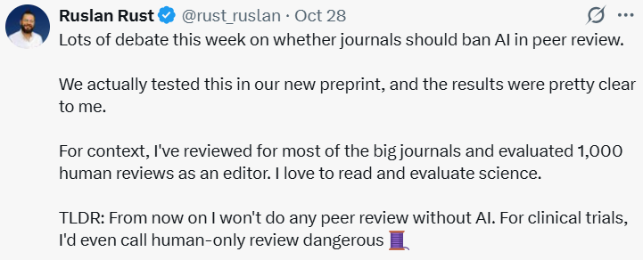

## Models find more errors than reviewers did

:::: {.columns}
::: {.column width="56%"}
```{=html}
<div class="shot"></div>
```

::: {.fragment fragment-index=1 .punchline}
Human reviewers found 27% of the major errors; each of 15 models found more, 53 to 96%.
:::
:::

::: {.column width="44%" .plate .fragment fragment-index=1}
{fig-alt="Percentage of inserted major and minor errors found per review: human reviewers about 27% of major errors; 15 language models between about 53% and 96%."}

::: {.tiny .muted}
Brian et al., medRxiv 2026, Fig. 1b (CC BY 4.0)
:::
:::
::::

```{=html}
<div class="pop fragment" data-fragment-index="2"></div>
```

::: notes
[0:30–1:45] The debate this autumn: should journals ban AI in peer review? Ruslan Rust's
group tested it. His conclusion: from now on he won't review without AI, and for
clinical trials he calls human-only review dangerous. [click] They repeated the classic
BMJ experiment: known errors inserted into reports of randomised trials, every review
scored against the same answer key. Human peer reviewers, in the 2004 study, found
about a quarter of the major errors. Every one of 15 current models, reading only the
text, found more: 53 to 96%. Caveats: a preprint, a historical human comparison,
language models as judges, and models that also flag concerns on clean reports.
[click] A second study, from Harvard, the same week: King and Worthington compared AI
reviews with paid human reviews that editors and authors had rated unusually good, and
the AI reviews were better by every measure they could construct: 124 papers, one review
each from Claude Opus 4.8 at its maximum reasoning setting, judged by another model and
by three former journal editors, who preferred the AI review in 26 of 30 judgments.
Also a working paper. Or as one researcher put it: "It's been true for a year at least."
:::

## Three kinds of review



::: {.fragment fragment-index=3 .punchline}
Our internal consistency review needs all three.
:::

::: notes
[1:45–2:30] More systematically, three kinds of review are changing. Peer review of
papers, for journals: King and Worthington's AI reviews beat paid expert reviews.
[click] The review of statistics and methods: the design, the estimand, the numbers.
That is what the preprint tested: methodological errors in trial reports, where every
model found more than the human reviewers. [click] And code: does it run, and does it do
what the text says? The preprint's authors say it themselves: errors in data handling or
analysis code are not visible in the text. There the AI has to run the code: Certify,
from Gary King, Yiqing Xu and Leo Yang at Harvard, has your own AI assistant rerun a
replication package and certifies that it reproduces the results. [click] Our internal
consistency review needs all three.
:::

## Internal consistency review

::: big
Sample size estimations, analysis plans, reports
:::



::: notes
[2:30–3:00] Our internal consistency review: sample size estimations, analysis plans and
reports go to a second statistician, who checks the methods, the numbers and the code.
[click] Where could AI come in? Before the second statistician, as a check the author
runs first, or alongside the reviewer? That is open. I have tried a few things, and I'll
show them, so that we can discuss this with some experience rather than in the abstract.
All of it is my own exploration, not something DKF runs or recommends.
:::

## Four approaches



::: notes
[3:00–3:30] Four approaches. The chat: paste and ask. [click] Your own pipeline, a script
through the API. [click] Review services: someone else's pipeline. [click] And then
something different: an agent that runs the code in the repository.
:::

## Paste it into the chat

::: crumbs
<span class="on">Chat</span><span>Script</span><span>Services</span><span>Agent</span>
:::



::: notes
[3:30–4:30] The simplest way is what the preprint tested. Paste the PDF and the source
into a chat and ask it to check whether the document is consistent. [click] Take the
strongest model, GPT Pro or Claude Fable or Opus, and set its effort to maximum.
[click] You get an answer, and it works surprisingly well; in my experience since
OpenAI's o1 pro, in December 2024. King and Worthington's AI reviews were made exactly
this way: one model at its maximum reasoning setting, given the paper and the
reviewer guidelines. What you don't get: a record of what was checked, the same answer
twice, or better data terms than your plan's. [click] Or you bring your own checklist,
as a skill, and call it by name: please review this using /dkf-document-check. A skill
is a folder of plain text. SKILL.md holds the rules, only documents you may share, the
print decides, the product's code never runs, and three checks in order: the documents
and their versions against protocol, SAP and registry; the printed numbers, each
recomputed by a script; the design, the estimand and the method. Next to it, references
on estimands, clinical guidelines and product profiles, and the small script. The model
reads only the names and descriptions of its skills until a request matches, then loads
the rest. Mine is the first stage of my review skills, adapted from the skills Joe
Francis released (research_skills, MIT licence); the agent's skills are built the same
way.
:::

## Your own script

::: crumbs
<span>Chat</span><span class="on">Script</span><span>Services</span><span>Agent</span>
:::



::: notes
[4:30–5:15] Instead of pasting by hand: the same through the API, from a Quarto
document, my review prototype. It takes the product's Quarto source and its PDF. Its
chunks hold the settings, in R; the prompt, from a text file; and the request, sent
with the Python SDK through reticulate. ellmer could send it too; the SDK gives me the
exact stop reason and a check that the model read the whole source. [click] One
request, paid per use, under the API's commercial data terms. [click] Every run is
saved, as Markdown and JSON, with its settings, its tokens and hashes of the prompt and
the inputs, and never overwritten. [click] Rendering the document shows the latest
review, with the prompt and the cost; for our SSEs, under a dollar fifty. [click] And that is the real reason to script it: you can test
it. Run it on test cases with known answers and score every run; in R, the vitals
package does this with ellmer, a port of Inspect, the Python framework for evaluating
language models. So you compare prompts, models and effort settings on cases you know.
The price is code that talks to one provider at one point in time.
:::

## How it is set up

::: crumbs
<span>Chat</span><span class="on">Script</span><span>Services</span><span>Agent</span>
:::

:::: {.columns}
::: {.column width="53%"}
::: where
review.qmd · the first chunk
:::

```r
cfg <- list(
  review_folder    = "to_be_reviewed",
  qmd_file         = "DEMO-TKA_SSE.qmd",
  pdf_file         = "DEMO-TKA_SSE.pdf",
  assignment       = "Is the sample size right?",
  anthropic_model  = "claude-opus-5-5",
  anthropic_effort = "high"
)
```
:::

::: {.column width="4%"}
:::

::: {.column width="43%"}
::: {.incremental .tight .compact}
- **Put** the .qmd and PDF in to_be_reviewed/
- **Set** cfg: files, questions, model, effort
- **Edit** prompt.md if you like: a checklist per product type
- **Run** the chunks; the last one sends the request
- **Render:** the latest review, its prompt and its cost
:::
:::
::::

::: notes
[5:15–6:00] How it is set up. On the left, the first chunk: which files, the assignment,
that is the questions the review must answer, the model and the effort. [click] You put
the product's Quarto source and PDF in the folder to_be_reviewed. [click] You set the
settings. [click] The prompt is a text file: a senior biostatistician's first pass,
with a checklist for each product type, the sample size estimation, the analysis
report, data preparation; and it must say what it could not check. [click] You run the
chunks; the last one sends the request. It is set to eval false, so rendering never
sends anything. [click] You render, and see the latest review, the prompt as sent and
the cost; what the review looks like is set in the prompt. One thing it checks itself: that the model read the whole source, to the last line; otherwise the
run is marked not completed.
:::

## Review services

::: crumbs
<span>Chat</span><span>Script</span><span class="on">Services</span><span>Agent</span>
:::



```{=html}
<div class="svc fragment" data-fragment-index="3">
  <div><div class="n"><a href="https://refine.ink">refine.ink</a></div><div class="t">paid, up to $50</div></div>
  <div><div class="n"><a href="https://reviewer3.com">reviewer3.com</a></div><div class="t">paid</div></div>
  <div><div class="n"><a href="https://paperreview.ai">paperreview.ai</a></div><div class="t">free · Stanford</div></div>
  <div><div class="n"><a href="https://openaireview.org">openaireview.org</a></div><div class="t">free · Chicago</div></div>
  <div><div class="n"><a href="https://github.com/isitcredible/reviewer2">Reviewer 2</a></div><div class="t open">open source · Joe Francis</div></div>
  <div><div class="n"><a href="https://coarse.ink">coarse.ink</a></div><div class="t open">open source</div></div>
  <div><div class="n"><a href="https://research.google/blog/analyzing-technical-documents-with-deep-review/">Deep Review</a></div><div class="t">free, 2 a week · Google</div></div>
  <div class="more"><div class="n">…</div><div class="t">more every month</div></div>
</div>
```

::: notes
[6:00–6:45] Others have built exactly such pipelines, with many more calls, and offer
them as services. You upload the PDF. [click] Behind it run fixed chains of model calls,
with prompts the vendor wrote; Reviewer 2's first stage, The Breaker, takes a
sledgehammer to the text, and later stages filter out what the aggression invents.
[click] You get a report. [click] There are more every month: Refine and Reviewer3 are
paid, Refine up to fifty dollars a paper; paperreview.ai from Stanford and openaireview
from Chicago are free; Joe Francis's Reviewer 2 and coarse.ink are open source; and in
October Google launched Deep Review, free for two reviews a week. All built for research
papers, and you upload to a third party. One could now build a more advanced pipeline of
one's own, along the lines of the open-source Reviewer 2. I went another way: an agent.
:::

## A coding agent in the repository

::: crumbs
<span>Chat</span><span>Script</span><span>Services</span><span class="on">Agent</span>
:::



::: notes
[6:45–8:15] The last step: a coding agent working in the product's repository, here
Claude Code on the web; Codex and others work the same way. An isolated cloud machine,
with tools that read files, run R and write logs, and the model outside it, which
decides the next step. [click] Into the machine goes a copy of the product's repository,
with my review skills as its instructions: what you type is one sentence, "review the
product with dkf-review, then write the consistency review"; the skills hold the rest.
[click] The model decides the next step; the tools carry it out, and the result comes
back. [click] Again and again, until it is done. So it does what no reader can: it runs
the code, recomputes the numbers and re-runs the simulations, and agents that did not
write a finding challenge it. [click] The output is the review, with a log
behind every number, pushed to a branch. [click]
And it never touches your computer. It runs on your Claude subscription, no API
credits. What it reads still goes to the provider, under your plan's terms. [click] And
the same agent can be started from a script, with the Agent SDK in Python or
TypeScript, or with claude -p from R: to run it over test cases with known answers, for
batch runs, with guardrails in code. That runs on an API key, billed per token; for one
review you don't need it (appendix).
:::

## The agent in practice

::: crumbs
<span>Chat</span><span>Script</span><span>Services</span><span class="on">Agent</span>
:::

::: {.incremental .tight}
- **Runs the code:** re-renders the product, recomputes the numbers, re-runs the
  simulations
- **Challenges its findings:** a fresh agent checks each one
- **Synthetic data** when patient data cannot be shared, so the code still runs
- **A log behind every number**, and the scripts that produced it
:::

::: {.fragment .punchline}
Still in development.
:::

::: notes
[8:15–9:00] What the agent adds over the script. [click] It runs the code: it
re-renders the product, recomputes the printed numbers and re-runs the simulations,
which no reader can. [click] It challenges its own findings: an agent that did not
write a finding checks it, in a fresh context. [click] Where patient data cannot be
shared, it builds synthetic data from the code, so the code runs and does what the text
says, though it never confirms a printed number. [click] Every number in the review has
a log behind it, and the scripts that produced it. [click] I am still
developing this. The skills are at version 0.3.1, so far tested on one synthetic test
case, where every run found all six planted issues (appendix); a second test case is
next.
:::

## Try it yourself

:::: {.columns}
::: {.column width="31%"}
::: punchline
The skill, in a chat
:::

::: where
stats_review · chat-skills
:::

```text
Please review this using
/dkf-document-check.
```

::: {.tight .compact}
- upload its ZIP in Claude
- attach the PDF and .qmd
- on your plan
:::
:::

::: {.column width="3.5%"}
:::

::: {.column width="31%" .fragment fragment-index=1}
::: punchline
The review document
:::

::: where
scto-ai-review · tools/2-api
:::

```text
review.qmd  prompt.md
to_be_reviewed/
```

::: {.tight .compact}
- open review.qmd in RStudio
- set cfg, run, render
- an API key, paid per use
:::
:::

::: {.column width="3.5%"}
:::

::: {.column width="31%" .fragment fragment-index=2}
::: punchline
The agent
:::

::: where
stats_review · skills-v0.3.1
:::

```text
Review the product with
dkf-review, then write
the consistency review.
```

::: {.tight .compact}
- claude.ai/code, on your plan
- your repo + stats_review
- setup: tools/web_setup.sh
- still in development
:::
:::
::::

::: {.fragment fragment-index=3 .scope}
**github.com/valentinklotzbuecher/scto-ai-review**: the kit, a handout, two test cases\
**github.com/valentinklotzbuecher/stats_review**: the review skills
:::

::: notes
[9:00–10:00] And you can try all three. The skill, in a chat: download its ZIP from
stats_review, the repository with my review skills, in the folder chat-skills; upload
it in Claude, with code execution on; attach the product's PDF and its Quarto source,
and type one sentence. It runs on your Claude plan. [click] The review document is in
the kit, the repository scto-ai-review, in the folder tools/2-api: open review.qmd in
RStudio, put the product in to_be_reviewed, set the settings, run the chunks and
render. You need an API key, paid per use. [click] And the agent, still in
development: Claude Code on the web, at claude.ai/code, on your Claude plan. You start
a session with your product's repository and stats_review, at the tag skills-v0.3.1;
its setup script, tools/web_setup.sh, installs R and Quarto in the cloud machine. You
type one sentence, and the review lands on a branch of your product's repository,
where you merge it. Try all three on the test cases first: synthetic sample size
estimations with planted issues and an answer key, so you can score what they find.
[click] Both repositories, with a handout that walks through each step.
:::

## To discuss

::: {.tight}
- What would you need to see before you sign a product an AI reviewed?
- Review results, not lines?
- Which checks stay with us: the estimand, the design?
- Should we write our products for an AI reader?
- A replication certificate with every product?
- Build our own tools, or wait for the next model?
- How will junior statisticians learn to review?
:::

::: notes
[10:00–20:00] To discuss. What would you need to see before you sign a product an AI
reviewed? Could our review become result-oriented: the AI goes through every line,
every number and every re-run, and we check that it tested enough, that each chunk,
section and analysis does what it says, and that the approach and the interpretation
hold? Even the author of the skills I build on says the results come from robots and
should be verified by humans. Which checks stay with us: the choice of estimand, the
clinical relevance, the design? If an AI reads our products first, should we write them
for it: the estimand in full, every assumption in the text and not only in the code,
every number traceable to the code that makes it? Certify, from Gary King, Yiqing Xu and
Leo Yang at Harvard, has your own AI assistant, Claude Code or Codex, rerun a
replication package on your computer, and certifies that rerunning the code produces
the results to be published: should our products carry such a certificate? Should we
build our own tools at all? Sutton's bitter lesson: hand-built machinery keeps losing to
general methods that use more computation. Rex Douglass, on the day Google launched Deep
Review, said he never built a review tool because "one of the big three does it and
it's over"; Joe Francis retired Reviewer 2 as obsolete; my own prototype dates with every
new model, and my skills will too. What carries over: test cases with known answers, review
standards, data rules (backup slide in the appendix). And how will junior statisticians
learn to review, if the AI does the line-by-line work? The preprint's last author calls
human-only review dangerous for clinical trials; is AI-only review? Thank you; the
links are in the appendix.
:::

# Appendix {.divider}

## A test case with a known answer

::: scope
A synthetic sample size estimation of two pages with six planted issues: two in the
text, two only in the code, two that need a calculation or a re-run.
:::

| | Found | Consequence stated | Time | Cost |
|:---|:-:|:-:|:-:|:-:|
| Chat | · | · | · | · |
| Chat with the skill | 6 of 6 | 5 of 5 | — | — |
| Your own script | · | · | · | · |
| Agent, quick | 6 of 6 | 5 of 5 | 34 min | $10 |
| Agent, standard | 6 of 6 | 5 of 5 | 3.4 h | $72 |

::: {.tiny .muted}
· not yet run; — not recorded. Quick: start to finished form; standard: model time.
Cost at API list prices; all runs were on a subscription. Not a blind test: the skills
and the test case were written in the same week.
:::

::: {.fragment .punchline}
All six found, and for the five that change the sample size or the power, by how much.
:::

::: notes
Backup for "The agent in practice". Does it work? I wrote a test case with a known answer: a synthetic sample
size estimation of two pages, with six planted issues, two in the text, two only in
the code, and two that need a calculation or a re-run. The agent found all six, in
every run, and so did the chat with the skill. [click] And for the five that change the
sample size or the power, they said by how much: at the correlation the code uses, the
design as written needs 80 evaluable participants per group, not 55. At quick depth
the agent took 34 minutes from start to the finished form, about ten dollars at API
list prices, on the subscription; the first run, at standard depth, three and a half
hours of model time, and it caught an error in my own answer key. The chat with the
skill never ran the product's code: its own arithmetic and small simulations were
enough here, because every planted issue can be derived from the print and the
source. A case where an error shows only when the code runs would separate the two.
Not a blind test: I wrote the skills and the test case in the same week, and the
skills already describe two of the planted issue types. The chat on its own and the
script come next on this table. That is what test cases are for: every new tool and
every new model is scored on the same case.
:::

## The bitter lesson

::: quote
"… general methods that leverage computation are ultimately the most effective, and by
a large margin."
:::

::: attribution
Rich Sutton, The Bitter Lesson, 2019
:::

```{=html}
<div class="pop fragment fade-in-then-out" data-fragment-index="1"></div>
<div class="pop fragment fade-in-then-out" data-fragment-index="2"></div>
```

::: {.fragment fragment-index=3}
::: {.tight}
- What carries over: test cases with known answers, review standards, data rules
:::
:::

::: notes
Backup for "Build our own tools, or wait for the next model?". Sutton's lesson from 70 years of AI
research: hand-built machinery keeps losing to general methods that use more
computation, and review tools are no exception. [click] Rex Douglass, on the day Google
launched Deep Review: he had thought about building a review tool twice a day for three
years, and didn't, because "one of the big three does it and it's over". [click] Later
that month Joe Francis retired Reviewer 2: he decided it was obsolete, and he now begins
his reviews with skills. My own prototype dates with every new model, and my skills will
too: tools are obsolete before they are finished. [click] What carries over to every new
model: test cases with known answers, standards for what a review must check, and rules
for what data may go where.
:::

## The Agent SDK

- Claude Code as a library (Python, TypeScript): the same tools, agent loop and skills
- Worth it for evals over many test cases, batch runs, and hard guardrails in code
- Not needed for one review; it does not fine-tune the model
- Runs on an API key, billed per token, unlike Claude Code on a subscription
- From R, the command-line `claude -p` does the same

## Links

::: {.small .tight}
- This talk, with a handout, the review document and two test cases: [github.com/valentinklotzbuecher/scto-ai-review](https://github.com/valentinklotzbuecher/scto-ai-review); the review skills: [github.com/valentinklotzbuecher/stats_review](https://github.com/valentinklotzbuecher/stats_review/tree/skills-v0.3.1)
- Brian et al., medRxiv 2026: [doi.org/10.64898/2026.10.25.26366455](https://doi.org/10.64898/2026.10.25.26366455)
- King and Worthington, working paper 2026: [gking.harvard.edu/peerless](https://gking.harvard.edu/peerless/)
- Services: [refine.ink](https://refine.ink), [reviewer3.com](https://reviewer3.com), [paperreview.ai](https://paperreview.ai), [openaireview.org](https://openaireview.org), [coarse.ink](https://coarse.ink), Google's [Deep Review](https://research.google/blog/analyzing-technical-documents-with-deep-review/)
- Certify, replication certificates run by your own AI assistant (King, Xu and Yang, Harvard): [certify.iq.harvard.edu](https://certify.iq.harvard.edu/)
- Reviewer 2: [github.com/isitcredible/reviewer2](https://github.com/isitcredible/reviewer2); research_skills: [github.com/isitcredible/research_skills](https://github.com/isitcredible/research_skills)
- Claude Code on the web: [code.claude.com/docs/en/claude-code-on-the-web](https://code.claude.com/docs/en/claude-code-on-the-web)
- Agent SDK: [code.claude.com/docs/en/agent-sdk](https://code.claude.com/docs/en/agent-sdk/overview)
- ellmer and vitals: [ellmer.tidyverse.org](https://ellmer.tidyverse.org), [vitals.tidyverse.org](https://vitals.tidyverse.org)
- Rich Sutton, The Bitter Lesson: [incompleteideas.net/IncIdeas/BitterLesson.html](http://www.incompleteideas.net/IncIdeas/BitterLesson.html)
:::
