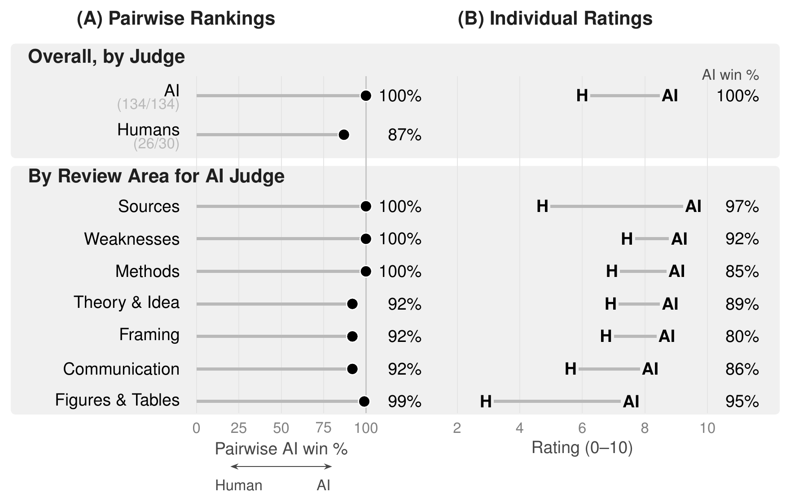

## Models find more errors than reviewers did

:::: {.columns}
::: {.column width="44%" .plate}
{fig-alt="Percentage of inserted major and minor errors found per review: human reviewers about 27% of major errors; 15 language models between about 53% and 96%."}

::: {.tiny .muted}
Brian et al., medRxiv 2026, Fig. 1b (CC BY 4.0)
:::
:::

::: {.column width="56%"}
::: punchline
Human reviewers found 27% of the major errors; each of 15 models found more, 53 to 96%.
:::
:::
::::

```{=html}
<div class="pop fragment fade-in-then-out" data-fragment-index="1"><figure class="popfig"><figcaption>King and Worthington, working paper, 28 October 2026, Fig. 1: 134 pairs of a human and an AI review of the same manuscript</figcaption></figure></div>
<div class="pop fragment" data-fragment-index="2"><div class="qcard solo">
<div class="quote">"From now on I won't do any peer review without AI. For clinical trials, I'd even call human-only review dangerous."</div>
<div class="attribution">Ruslan Rust, last author, on X, 28 October 2026</div>
</div></div>
```

::: notes
[0:30–1:45] The debate this autumn: should journals ban AI in peer review? Ruslan Rust's
group tested it. They repeated the classic BMJ experiment: known errors inserted into
reports of randomised trials, every review scored against the same answer key. Human
peer reviewers, in the 2004 study, found about a quarter of the major errors. Every one
of 15 current models, reading only the text, found more: 53 to 96%. Caveats: a
preprint, a historical human comparison, language models as judges, and models that
also flag concerns on clean reports. [click] A second study, from Harvard, the same
week: King and Worthington compared AI reviews with paid human reviews that editors and
authors had rated unusually good, and the AI reviews were better by every measure they
could construct: 124 papers, one review each from Claude Opus 4.8 at its maximum
reasoning setting, judged by another model and by three former journal editors, who
preferred the AI review in 26 of 30 judgments. Also a working paper. Or as one
researcher put it: "It's been true for a year at least." [click] And Rust's own
conclusion: from now on he won't review without AI, and for clinical trials he calls
human-only review dangerous.
:::

## Internal consistency review

::: big
Sample size estimations, analysis plans, reports
:::



::: notes
[1:45–2:15] Our internal consistency review: sample size estimations, analysis plans and
reports go to a second statistician, who checks the methods, the numbers and the code.
Both studies read only the text; errors in data handling or analysis code, the
preprint's authors note, are not visible there.
[click] Where could AI come in? Before the second statistician, as a check the author
runs first, or alongside the reviewer? That is open. I have tried a few things, and I'll
show them, so that we can discuss this with some experience rather than in the abstract.
All of it is my own exploration, not something DKF runs or recommends.
:::

## Three approaches



::: notes
[2:15–2:45] Three approaches. The chat: paste and ask. [click] A script through the
API, here my review prototype; the review services, someone else's pipeline, come in
as templates for it. [click] And then something different: an agent that runs the code in
the repository.
:::

## Paste it into the chat

::: crumbs
<span class="on">Chat</span><span>Script</span><span>Agent</span>
:::



::: notes
[2:45–3:45] The simplest way is what the preprint tested. Paste the PDF and the source
into a chat and ask it to check whether the document is consistent. [click] Take the
strongest model, GPT Pro or Claude Fable or Opus, and set its effort to maximum.
[click] You get an answer, and it works surprisingly well; in my experience since
OpenAI's o1 pro, in December 2024. King and Worthington's AI reviews were made exactly
this way: one model at its maximum reasoning setting, given the paper and the
reviewer guidelines. What you don't get: a record of what was checked, the same answer
twice, or better data terms than your plan's. [click] Or you bring your own checklist,
as a skill, and call it by name: please review this using /dkf-document-check. A skill
is a folder of plain text. SKILL.md holds the rules, only documents you may share, the
print decides, the product's code never runs, and three checks in order: the documents
and their versions against protocol, SAP and registry; the printed numbers, each
recomputed by a script; the design, the estimand and the method. Next to it, references
on estimands, clinical guidelines and product profiles, and the small script. The model
reads only the names and descriptions of its skills until a request matches, then loads
the rest. Mine is the first stage of my review skills, adapted from the skills Joe
Francis released (research_skills, MIT licence); the agent's skills are built the same
way.
:::

## An API review prototype

::: crumbs
<span>Chat</span><span class="on">Script</span><span>Agent</span>
:::



::: notes
[3:45–4:30] Instead of pasting by hand: the same through the API, from a Quarto
document, my review prototype. It takes the product's Quarto source and its PDF. Its
chunks hold the settings, in R; the prompt, from a text file; and the request, sent
with the Python SDK through reticulate. ellmer could send it too; the SDK gives me the
exact stop reason and a check that the model read the whole source. [click] One
request, paid per use, under the API's commercial data terms. [click] Every run is
saved, as Markdown and JSON, with its settings, its tokens and hashes of the prompt and
the inputs, and never overwritten. [click] Rendering the document shows the latest
review, with the prompt and the cost; for our SSEs, under a dollar fifty. [click] And that is the real reason to script it: you can test
it. Run it on test cases with known answers and score every run; in R, the vitals
package does this with ellmer, a port of Inspect, the Python framework for evaluating
language models. So you compare prompts, models and effort settings on cases you know.
The price is code that talks to one provider at one point in time.
:::

## How it is set up

::: crumbs
<span>Chat</span><span class="on">Script</span><span>Agent</span>
:::

:::: {.columns}
::: {.column width="53%"}
::: where
review.qmd · the first chunk
:::

```r
cfg <- list(
  review_folder    = "to_be_reviewed",
  qmd_file         = "DEMO-TKA_SSE.qmd",
  pdf_file         = "DEMO-TKA_SSE.pdf",
  assignment       = "Is the sample size right?",
  anthropic_model  = "claude-opus-5-5",
  anthropic_effort = "high"
)
```
:::

::: {.column width="4%"}
:::

::: {.column width="43%"}
::: {.incremental .tight .compact}
- **Put** the .qmd and PDF in to_be_reviewed/
- **Set** cfg: files, questions, model, effort
- **Edit** prompt.md if you like: a checklist per product type
- **Run** the chunks; the last one sends the request
- **Render:** the latest review, its prompt and its cost
:::
:::
::::

::: notes
[4:30–5:15] How it is set up. On the left, the first chunk: which files, the assignment,
that is the questions the review must answer, the model and the effort. [click] You put
the product's Quarto source and PDF in the folder to_be_reviewed. [click] You set the
settings. [click] The prompt is a text file: a senior biostatistician's first pass,
with a checklist for each product type, the sample size estimation, the analysis
report, data preparation; and it must say what it could not check. [click] You run the
chunks; the last one sends the request. It is set to eval false, so rendering never
sends anything. [click] You render, and see the latest review, the prompt as sent and
the cost; what the review looks like is set in the prompt. One thing it checks itself: that the model read the whole source, to the last line; otherwise the
run is marked not completed.
:::

## Review services as templates

::: crumbs
<span>Chat</span><span class="on">Script</span><span>Agent</span>
:::



```{=html}
<div class="svc fragment" data-fragment-index="3">
  <div><div class="n"><a href="https://refine.ink">refine.ink</a></div><div class="t">paid, up to $50</div></div>
  <div><div class="n"><a href="https://reviewer3.com">reviewer3.com</a></div><div class="t">paid</div></div>
  <div><div class="n"><a href="https://paperreview.ai">paperreview.ai</a></div><div class="t">free · Stanford</div></div>
  <div><div class="n"><a href="https://openaireview.org">openaireview.org</a></div><div class="t">free · Chicago</div></div>
  <div><div class="n"><a href="https://github.com/isitcredible/reviewer2">Reviewer 2</a></div><div class="t open">open source · Joe Francis</div></div>
  <div><div class="n"><a href="https://coarse.ink">coarse.ink</a></div><div class="t open">open source</div></div>
  <div><div class="n"><a href="https://research.google/blog/analyzing-technical-documents-with-deep-review/">Deep Review</a></div><div class="t">free, 2 a week · Google</div></div>
  <div class="more"><div class="n">…</div><div class="t">more every month</div></div>
</div>
```

::: notes
[5:15–6:15] Others have built such pipelines, with many more calls, and offer them as
services; for the script I just showed, they are templates. You upload the PDF.
[click] Behind it runs a fixed chain of model calls, with prompts the vendor wrote.
[click] You get a report. [click] There are more every month. Refine is the oldest:
founded by Ben Golub, an economist at Northwestern, and Yann Calvó López; it is seen as
the gold standard, and costs up to fifty dollars a paper. Reviewer3 is paid as well;
paperreview.ai from Stanford and openaireview from Chicago are free; coarse.ink is open
source, apparently reverse-engineered from Refine; and in October Google launched Deep
Review, free for two reviews a week. Reviewer 2, by Joe Francis, is open source: more
than thirty chained calls, fifteen to forty-five minutes and a few dollars a paper. Its
first stage, The Breaker, takes a sledgehammer to the text, and a verification cascade
then removes what the aggression invents. All are built for research papers, and all but
the open-source ones mean uploading to a third party. And they are no magic: as Aniket
Panjwani worked out on X, if one Refine review costs fifty dollars and ten cost three
hundred, its inference costs at most about thirty dollars a review, while a ChatGPT Pro
or Claude Max plan buys thousands of dollars' worth of tokens a month at API prices; a
reasonable set of subagents on your own subscription should do better. The hard part,
he says, is the evals: well-constructed public test cases would be a public good. I was
planning to fork Reviewer 2, to see if I could improve it, or learn from it for my own
script.
:::

## The bitter lesson

:::: {.columns}
::: {.column width="47%"}
::: quote
"Reviewer 2—he dead. … I will also be open sourcing a better system shortly."

"Yes, I decided it was obsolete. Something better and free coming shortly."
:::

::: attribution
Joe Francis on X, 26 October 2026
:::
:::

::: {.column width="5%"}
:::

::: {.column width="48%"}
::: {.fragment fragment-index=1}
::: quote
"… general methods that leverage computation are ultimately the most effective, and by
a large margin."
:::

::: attribution
Rich Sutton, The Bitter Lesson, 2019
:::
:::

::: {.fragment fragment-index=2 .punchline}
How much more to build, when tools become obsolete this fast?
:::
:::
::::

```{=html}
<div class="pop fragment" data-fragment-index="3"><div class="qcard">
<div class="quote">"These are the three skills that I use to begin my reviews, now freely available for anyone to use: … /review: Point your agent at a folder with an article, its supplementary material, and replication package, and it will assess it."</div>
<div class="quote">"… the results have been produced by robots and should be verified by humans."</div>
<div class="attribution">Joe Francis on X, 26 October 2026, releasing his skills</div>
</div></div>
```

::: notes
[6:15–7:00] And this is what happened to Reviewer 2. On 26 October Joe Francis took it
offline: he decided it was obsolete, and something better and free was coming shortly.
[click] That is the bitter lesson, Rich Sutton's, from seventy years of AI research:
hand-built machinery keeps losing to general methods that use more computation. Or, as
Rex Douglass put it on the day Google launched Deep Review: "one of the big three does
it and it's over". [click] So how much more should I build on my script, when tools
become obsolete this fast? [click] The same day, Joe released the skills he begins his
reviews with: point your agent at a folder with an article, its supplementary material
and replication package, and it assesses it; a second skill verifies that review. And,
he writes, the results come from robots and should be verified by humans. What I did
based on that is the agent.
:::

## A coding agent in the repository

::: crumbs
<span>Chat</span><span>Script</span><span class="on">Agent</span>
:::



::: notes
[7:00–9:00] What I did instead: a coding agent working in the product's repository,
with skills adapted from Joe's as its instructions; here Claude Code on the web, and
Codex and others work the same way. It starts from the product's repository, with my
review skills in it as the agent's instructions: what you type is one sentence, "review
the product with dkf-review, then write the consistency review"; the skills hold the
rest. [click] Tools read the files, run R and write logs. [click] The agent decides the
next step, with its model, which runs at the provider; the tools carry it out, and the
result comes back, again and again, until it is done. It runs on your Claude
subscription, no API credits. [click] The repository and the tools sit in an isolated
cloud machine, with the model outside; it never touches your computer. What it reads
still goes to the provider, under your plan's terms. [click] The output is the review,
with a log behind every number, pushed to a branch. [click] And the same agent can be
started from a script, with the Agent SDK in Python or TypeScript, or with claude -p
from R: to run it over test cases with known answers, for batch runs, with guardrails in
code. That runs on an API key, billed per token; for one review you don't need it.
[click] What it adds over the script. It runs the code: it re-renders the product,
recomputes the printed numbers and re-runs the simulations, which no reader can. It
challenges its own findings: an agent that did not write a finding checks it, in a
fresh context. Where patient data cannot be shared, it builds synthetic data from the
code, so the code runs and does what the text says, though it never confirms a printed
number. And everything it writes, every script, log and result, is committed with the
product under version control, so it could become part of the product's replication
package. I am still developing this. The skills are at version 0.3.1, so far tested on
one synthetic test case, a two-page sample size estimation with six planted issues:
every run found all six, and said by how much the five that matter change the sample
size or the power; the quick run took 34 minutes, about ten dollars at API list
prices. A second test case is next.
:::

## Try it yourself

:::: {.columns}
::: {.column width="31%"}
::: punchline
The skill, in a chat
:::

::: where
stats_review · chat-skills
:::

```text
Please review this using
/dkf-document-check.
```

::: {.tight .compact}
- upload its ZIP in Claude
- attach the PDF and .qmd
- on your plan
:::
:::

::: {.column width="3.5%"}
:::

::: {.column width="31%" .fragment fragment-index=1}
::: punchline
The review document
:::

::: where
scto-ai-review · tools/2-api
:::

```text
review.qmd  prompt.md
to_be_reviewed/
```

::: {.tight .compact}
- open review.qmd in RStudio
- set cfg, run, render
- an API key, paid per use
:::
:::

::: {.column width="3.5%"}
:::

::: {.column width="31%" .fragment fragment-index=2}
::: punchline
The agent
:::

::: where
stats_review · skills-v0.3.1
:::

```text
Review the product with
dkf-review, then write
the consistency review.
```

::: {.tight .compact}
- claude.ai/code, on your plan
- your repo + stats_review
- setup: tools/web_setup.sh
- still in development
:::
:::
::::

::: {.fragment fragment-index=3 .scope}
**github.com/valentinklotzbuecher/scto-ai-review**: the kit, a handout, two test cases\
**github.com/valentinklotzbuecher/stats_review**: the review skills
:::

::: notes
[9:00–10:00] And you can try all three. The skill, in a chat: download its ZIP from
stats_review, the repository with my review skills, in the folder chat-skills; upload
it in Claude, with code execution on; attach the product's PDF and its Quarto source,
and type one sentence. It runs on your Claude plan. [click] The review document is in
the kit, the repository scto-ai-review, in the folder tools/2-api: open review.qmd in
RStudio, put the product in to_be_reviewed, set the settings, run the chunks and
render. You need an API key, paid per use. [click] And the agent, still in
development: Claude Code on the web, at claude.ai/code, on your Claude plan. You start
a session with your product's repository and stats_review, at the tag skills-v0.3.1;
its setup script, tools/web_setup.sh, installs R and Quarto in the cloud machine. You
type one sentence, and the review lands on a branch of your product's repository,
where you merge it. Try all three on the test cases first: synthetic sample size
estimations with planted issues and an answer key, so you can score what they find.
[click] Both repositories, with a handout that walks through each step.
:::

## To discuss

::: {.tight}
- How should AI complement our review? For the author, the reviewer or both? How deep?
- Review results, not lines?
- What would you need to see before you sign a product an AI reviewed?
:::

::: group
Thinking further ahead
:::

::: {.tight}
- A checklist learned from our past reviews?
- Should we write our products for AI readers?
- A replication certificate with every product?
- Build our own tools, or wait for the next model?
- Implications for teaching: how to train staff, how fast to adopt?
:::

::: notes
[10:00–20:00] To discuss. First, here and now: how should AI complement our internal
review? For whom: the author, as a check before the second statistician, the reviewer,
alongside the review, or both? And how deep: one call that reads, or an agent that runs
everything? One reason to want it: a single reviewer sees only part of what
more reviewers would raise. In the NeurIPS 2021 reviews, one reviewer raised about a fifth
of the issues that all of a paper's reviewers raised together; an AI that applies the
same checks to every product takes some of the luck out of who reviews it. Could our
review become result-oriented: the AI goes through every line, every number and every
re-run, and we check that it tested enough, that each chunk, section and analysis does
what it says, and that the approach and the interpretation hold? A caution from this
month: the latest GPT and Claude models draw about 62% of their review weaknesses from
the appendix, human reviewers about 8%; they audit every detail and rarely engage with
the core of the paper; in ICLR's human reviews that share has risen from below 10% to
28% since the newest models came out. The
authors' advice: use them as a tool for checking the details, not as the judge of what
matters most. That judgement stays with us. Even the author of the skills I build on says the results come from robots and
should be verified by humans. And what would you need to see before you sign a product
an AI reviewed? Then, thinking further ahead. Liu, Guo, Hartline and Hullman
turned a corpus of past reviews into a checklist of criticisms: with language-model
reviewers it cut the error of a three-reviewer committee by 58% on NeurIPS and 21% on
ICLR, and in a small study with 20 people it more than halved the error of a paper
ranking. Could our own archive of review forms become such a checklist, for the human
reviewer and the AI alike? If an AI reads our products first, should
we write them for it: the estimand in full, every assumption in the text and not only in
the code, every number traceable to the code that makes it? Certify, from Gary King,
Yiqing Xu and Leo Yang at Harvard, has your own AI assistant, Claude Code or Codex, rerun
a replication package on your computer, and certifies that rerunning the code produces
the results to be published: should our products carry such a certificate? Should we
build our own tools at all, after the bitter lesson? My own prototype dates with every
new model, and my skills will too. What carries over to every new model: test cases with
known answers, standards for what a review must check, rules for what data may go
where. And the implications: for teaching, how will junior statisticians learn to review
if the AI does the line-by-line work; how do we train our staff; and how fast should we
adopt? The preprint's last author calls human-only review dangerous for clinical
trials; is AI-only review? Thank you; the links are in the appendix.
:::

# Appendix {.divider}

## Links: the talk and its tools

::: {.small .tight}
- **This talk**, with a handout, the review document and two test cases: [github.com/valentinklotzbuecher/scto-ai-review](https://github.com/valentinklotzbuecher/scto-ai-review); the review skills: [github.com/valentinklotzbuecher/stats_review](https://github.com/valentinklotzbuecher/stats_review/tree/skills-v0.3.1)
- **Agents:** [Claude Code on the web](https://code.claude.com/docs/en/claude-code-on-the-web); the [Agent SDK](https://code.claude.com/docs/en/agent-sdk/overview)
- **The API:** [Claude models, effort and prices](https://platform.claude.com/docs/en/about-claude/models/overview); in R, [ellmer](https://ellmer.tidyverse.org), [vitals](https://vitals.tidyverse.org) (evaluations), [ragnar](https://ragnar.tidyverse.org) (retrieval) and [reticulate](https://rstudio.github.io/reticulate/) (Python from R)
- **Services:** [refine.ink](https://refine.ink), [reviewer3.com](https://reviewer3.com), [paperreview.ai](https://paperreview.ai), [openaireview.org](https://openaireview.org), [coarse.ink](https://coarse.ink), Google's [Deep Review](https://research.google/blog/analyzing-technical-documents-with-deep-review/), [QED Science](https://www.qedscience.com/)
- **Open source:** [Reviewer 2](https://github.com/isitcredible/reviewer2) and [research_skills](https://github.com/isitcredible/research_skills), by Joe Francis
- **Certify**, replication certificates run by your own AI assistant (King, Xu and Yang, Harvard): [certify.iq.harvard.edu](https://certify.iq.harvard.edu/)
:::

## Links: studies

:::: {.columns}
::: {.column width="49%"}
::: links
**In this talk**

- Brian et al., medRxiv 2026: [doi.org/10.64898/2026.10.25.26366455](https://doi.org/10.64898/2026.10.25.26366455)
- King and Worthington, working paper 2026: [gking.harvard.edu/peerless](https://gking.harvard.edu/peerless/)
- Liu et al., learned checklists against the reviewer lottery: [arXiv 2610.28666](https://arxiv.org/abs/2610.28666)
- Ghosh et al., AI reviews biased towards the appendix: [arXiv 2611.17811](https://arxiv.org/abs/2611.17811)
- Sutton, [The Bitter Lesson](http://www.incompleteideas.net/IncIdeas/BitterLesson.html), 2019

**Our Unjournal project**

- Klotzbücher, Reinstein, Pacchiardi and Zhang, Just Ask the Model: one-shot LLM research evaluation and structured expert review: [llm-uj-research-eval.netlify.app](https://llm-uj-research-eval.netlify.app/)
:::
:::

::: {.column width="2%"}
:::

::: {.column width="49%"}
::: links
**AI in peer review**

- Thakkar et al., randomized LLM feedback to reviewers: [Nature Machine Intelligence 2026](https://doi.org/10.1038/s42256-026-01188-x)
- Kim et al., a randomized experiment at ICML 2026: [arXiv 2609.19420](https://arxiv.org/abs/2609.19420)
- Biswas et al., the AAAI-26 AI review pilot: [arXiv 2604.13940](https://arxiv.org/abs/2604.13940)
- Zancanaro et al., LLM and human reviews compared blind in a cardiology journal: [EHJ Imaging Methods and Practice 2026](https://doi.org/10.1093/ehjimp/qyag097)
- Russo Latona et al., the AI review lottery: [arXiv 2405.02150](https://doi.org/10.48550/arXiv.2405.02150)
- Choi et al., invisible text injection: [JAMA Network Open 2026](https://doi.org/10.1001/jamanetworkopen.2025.52099)

**Analysis and reproducibility**

- Asher et al., do Claude Code and Codex p-hack? 2026: [replication archive](https://github.com/janetmalzahn/llm-phacking)
- Xu and Yang, AI-assisted reanalysis at scale: [2026](https://yiqingxu.org/papers/2026_ai/AI_reproducibility.pdf)
- Brodeur et al., human, AI-assisted and AI-led teams on reproducibility: [2025](https://hdl.handle.net/10419/308508)
- Kohler et al., agentic reproduction from the methods section: [arXiv 2604.21965](https://arxiv.org/abs/2604.21965)
- Son et al., FLAWS, finding errors in papers: [arXiv 2511.21843](https://arxiv.org/abs/2511.21843)
:::
:::
::::

## Links: learning

::: {.small .tight}
- [Anthropic Academy](https://anthropic.skilljar.com/), free courses: Building with the Anthropic SDK; Claude Code in Action
- Hadley Wickham, [Using LLMs with ellmer](https://sites.google.com/view/dariia-mykhailyshyna/main/r-workshops-for-ukraine) (R Workshops for Ukraine), and its scripts, [github.com/hadley/workshop-llm-hackathon](https://github.com/hadley/workshop-llm-hackathon)
- Paul Goldsmith-Pinkham, [Claude Code for applied economists](https://bcf.princeton.edu/events/paul-goldsmith-pinkham-mini-series-on-claude-code-for-applied-economists/) (Princeton, a mini-series)
- Chris Blattman's collection on Claude for researchers: [claudeblattman.com](https://claudeblattman.com/)
- [reproai.org](https://reproai.org/): reproducibility and AI in research
- Ethan Mollick, [One Useful Thing](https://www.oneusefulthing.org/), to stay current
:::
