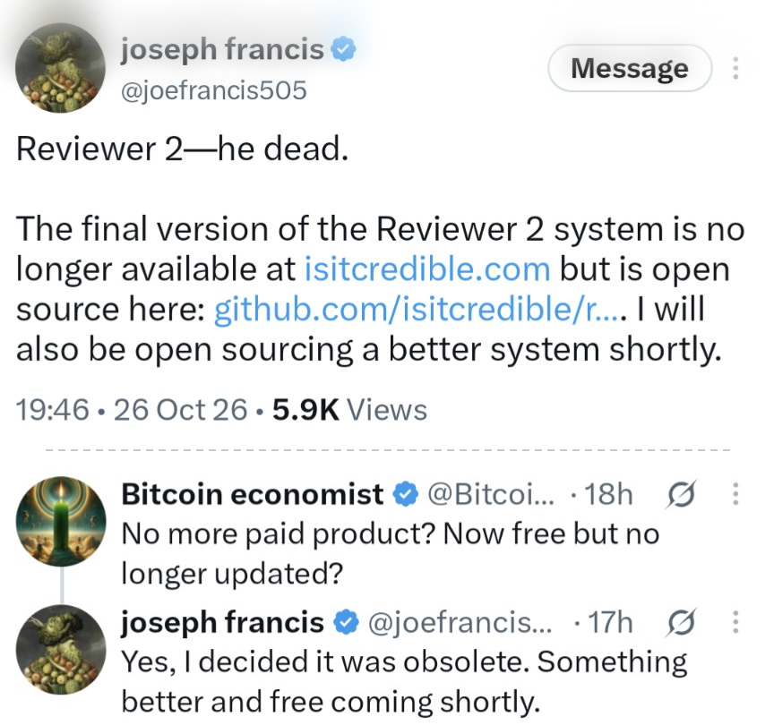
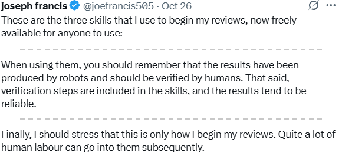

## Models find more errors than reviewers did

:::: {.columns}
::: {.column width="56%"}
```{=html}
<div class="shot"></div>
```
:::

::: {.column width="44%" .plate .fragment fragment-index=1}
{fig-alt="Percentage of inserted major and minor errors found per review: human reviewers about 27% of major errors; 15 language models between about 53% and 96%."}

::: {.tiny .muted}
Brian et al., medRxiv 2026, Fig. 1b (CC BY 4.0)
:::
:::
::::

```{=html}
<div class="pop fragment" data-fragment-index="2"></div>
```

::: notes
[0:30–1:45] The debate this autumn: should journals ban AI in peer review? Ruslan Rust's
group tested it. They repeated the classic BMJ experiment: known errors inserted into
reports of randomised trials, every review scored against the same answer key. His
conclusion: from now on he won't review without AI, and for clinical trials he calls
human-only review dangerous. [click] The forest plot: human peer reviewers, in the 2004
study, found about a quarter of the major errors. Every one of 15 current models,
reading only the text, found more: 53 to 96%. Caveats: a preprint, a historical human
comparison, language models as judges, and models that also flag concerns on clean
reports. [click] A second study, from Harvard, the same week: King and Worthington
compared AI reviews with paid human reviews that editors and authors had rated
unusually good, and the AI reviews were better by every measure they could construct:
124 papers, one review each from Claude Opus 4.8 at its maximum reasoning setting,
judged by another model and by three former journal editors, who preferred the AI
review in 26 of 30 judgments. Also a working paper. Or as one researcher put it: "It's
been true for a year at least." So the question is less whether to use these tools
than how.
:::

## Five ways to an AI review

::: scope
Reviewing a statistical product: its **methods**, its **numbers** and its **code**.
:::

```{=html}
<svg class="dg" viewBox="0 0 1100 410" role="img" aria-label="Five steps, rising from left to right: chat, API, review services, skill, agent. From reading what you give it to running the code in the repository.">
  <defs><marker id="m0" viewBox="0 0 10 10" refX="9" refY="5" markerWidth="8" markerHeight="8" orient="auto-start-reverse"><path d="M0,0 L10,5 L0,10 z" fill="#2C3A2F"/></marker></defs>
  <rect class="box" x="20" y="210" width="196" height="130"/>
  <text class="mono" x="36" y="242" font-size="16">01</text>
  <text class="strong" x="36" y="276" font-size="27">Chat</text>
  <text class="soft" x="36" y="308" font-size="18">paste and ask</text>
  <g class="fragment" data-fragment-index="1">
  <rect class="box" x="230" y="175" width="196" height="165"/>
  <text class="mono" x="246" y="207" font-size="16">02</text>
  <text class="strong" x="246" y="241" font-size="27">API</text>
  <text class="soft" x="246" y="273" font-size="18">same, scripted</text>
  </g>
  <g class="fragment" data-fragment-index="2">
  <rect class="box" x="440" y="140" width="196" height="200"/>
  <text class="mono" x="456" y="172" font-size="16">03</text>
  <text class="strong" x="456" y="206" font-size="27">Services</text>
  <text class="soft" x="456" y="238" font-size="18">many, paid or open</text>
  </g>
  <g class="fragment" data-fragment-index="3">
  <rect class="box" x="650" y="105" width="196" height="235"/>
  <text class="mono" x="666" y="137" font-size="16">04</text>
  <text class="strong" x="666" y="171" font-size="27">Skill</text>
  <text class="soft" x="666" y="203" font-size="18">loads a checklist</text>
  </g>
  <g class="fragment" data-fragment-index="4">
  <rect class="model" x="860" y="70" width="196" height="270"/>
  <text class="mono" x="876" y="102" font-size="16">05</text>
  <text class="strong" x="876" y="136" font-size="27">Agent</text>
  <text class="soft" x="876" y="168" font-size="18">runs the code</text>
  </g>
  <line class="arrow" x1="20" y1="368" x2="1078" y2="368" marker-end="url(#m0)"/>
  <text class="mono" x="20" y="400" font-size="15">READS WHAT YOU GIVE IT</text>
  <text class="mono" x="1080" y="400" font-size="15" text-anchor="end">RUNS THE CODE IN THE REPOSITORY</text>
</svg>
```

::: notes
[1:45–2:30] Five ways to get an AI review of a statistical product, from a model that
reads what you give it to an agent that runs the code. The chat, [click] the same
through the API, [click] review services, [click] a skill, [click] and an agent working
in the repository. Review here means the whole product: the statistical methods, the
design, the estimand, the sample size and the analysis, the printed numbers, and the
code. Everything today is my own exploration, not something DKF runs or recommends.
:::

## Paste it into the chat

::: crumbs
<span class="on">Chat</span><span>API</span><span>Services</span><span>Skill</span><span>Agent</span>
:::

::: big
Strongest model, maximum effort
:::

```{=html}
<svg class="dg" style="max-height: 320px" viewBox="0 0 640 200" role="img" aria-label="You paste the PDF and the Quarto source into a chat and ask whether it is consistent; one model at maximum effort reads them and answers.">
  <defs><marker id="m1" viewBox="0 0 10 10" refX="9" refY="5" markerWidth="8" markerHeight="8" orient="auto-start-reverse"><path d="M0,0 L10,5 L0,10 z" fill="#2C3A2F"/></marker></defs>
  <text class="soft" x="10" y="26" font-size="20" font-style="italic">“Please check if this is consistent.”</text>
  <path class="doc" d="M10 70 h52 l18 18 v68 h-70 z"/><path class="fold" d="M62 70 v18 h18"/>
  <text class="mono" x="45" y="130" font-size="15" text-anchor="middle">PDF</text>
  <path class="doc" d="M95 70 h52 l18 18 v68 h-70 z"/><path class="fold" d="M147 70 v18 h18"/>
  <text class="mono" x="130" y="130" font-size="15" text-anchor="middle">.QMD</text>
  <g class="fragment" data-fragment-index="1">
  <line class="arrow" x1="180" y1="113" x2="240" y2="113" marker-end="url(#m1)"/>
  <text class="mono" x="210" y="100" font-size="13" text-anchor="middle">PASTE</text>
  <rect class="model" x="248" y="73" width="190" height="80"/>
  <text class="strong" x="343" y="108" font-size="23" text-anchor="middle">model</text>
  <text x="343" y="136" font-size="17" text-anchor="middle">maximum effort</text>
  </g>
  <g class="fragment" data-fragment-index="2">
  <line class="arrow" x1="438" y1="113" x2="498" y2="113" marker-end="url(#m1)"/>
  <rect class="out" x="505" y="83" width="125" height="60"/>
  <text x="567" y="120" font-size="21" text-anchor="middle">answer</text>
  </g>
</svg>
```

::: notes
[2:30–3:30] The simplest way is what the preprint tested. Paste the PDF and the source
into a chat and ask it to check whether the document is consistent. [click] Take the
strongest model, GPT Pro or Claude Fable or Opus, and set its effort to maximum.
[click] You get an answer, and it works surprisingly well; in my experience since
OpenAI's o1 pro, in December 2024. King and Worthington's AI reviews were made exactly
this way: one model at its maximum reasoning setting, given the paper and the
reviewer guidelines. What you don't get: a record of what was checked,
the same answer twice, or better data terms than your plan's.
:::

## The same, as a script

::: crumbs
<span>Chat</span><span class="on">API</span><span>Services</span><span>Skill</span><span>Agent</span>
:::

```{=html}
<svg class="dg" style="max-height: 340px" viewBox="0 0 700 232" role="img" aria-label="A script, in R with ellmer or in Python with the providers' SDK libraries, sends each of many documents to the model with the same prompt, paid per use, and collects a table with one row per document, plus a log of every run. With tools in a loop, the same libraries run an agent.">
  <defs><marker id="m2" viewBox="0 0 10 10" refX="9" refY="5" markerWidth="8" markerHeight="8" orient="auto-start-reverse"><path d="M0,0 L10,5 L0,10 z" fill="#2C3A2F"/></marker></defs>
  <path class="doc" d="M10 30 h46 l16 16 v62 h-62 z"/>
  <path class="doc" d="M24 44 h46 l16 16 v62 h-62 z"/>
  <path class="doc" d="M38 58 h46 l16 16 v62 h-62 z"/><path class="fold" d="M84 58 v16 h16"/>
  <text class="mono" x="69" y="112" font-size="13" text-anchor="middle">DOC N</text>
  <text class="mono" x="58" y="170" font-size="13" text-anchor="middle">MANY DOCUMENTS</text>
  <g class="fragment" data-fragment-index="1">
  <line class="arrow" x1="110" y1="97" x2="160" y2="97" marker-end="url(#m2)"/>
  <rect class="tool" x="166" y="52" width="160" height="92"/>
  <text class="strong" x="246" y="84" font-size="22" text-anchor="middle">script</text>
  <text x="246" y="110" font-size="16" text-anchor="middle">R: ellmer</text>
  <text x="246" y="132" font-size="16" text-anchor="middle">Python: SDKs</text>
  <path class="arrow" d="M205 52 C 205 18, 287 18, 287 48" marker-end="url(#m2)"/>
  <text class="mono" x="246" y="14" font-size="12" text-anchor="middle">SAME PROMPT, EACH DOCUMENT</text>
  </g>
  <g class="fragment" data-fragment-index="2">
  <line class="arrow" x1="326" y1="97" x2="372" y2="97" marker-end="url(#m2)"/>
  <rect class="model" x="378" y="57" width="120" height="80"/>
  <text class="strong" x="438" y="104" font-size="22" text-anchor="middle">model</text>
  <text class="mono" x="438" y="46" font-size="12" text-anchor="middle">PAY PER USE</text>
  </g>
  <g class="fragment" data-fragment-index="3">
  <line class="arrow" x1="498" y1="97" x2="548" y2="97" marker-end="url(#m2)"/>
  <rect class="out" x="554" y="47" width="140" height="100"/>
  <text class="strong" x="624" y="84" font-size="19" text-anchor="middle">table + log</text>
  <text x="624" y="110" font-size="15" text-anchor="middle">one row per</text>
  <text x="624" y="130" font-size="15" text-anchor="middle">document</text>
  </g>
  <g class="fragment" data-fragment-index="4">
  <path class="arrow cut" d="M438 140 C 438 196, 246 200, 246 150" marker-end="url(#m2)"/>
  <text class="mono" x="342" y="222" font-size="12" text-anchor="middle">WITH TOOLS IN A LOOP: AN AGENT</text>
  </g>
</svg>
```

::: notes
[3:30–5:00] The same idea through the API, from a script, for many documents. [click] The
script, in R with the ellmer package or in Python with the providers' SDK libraries,
sends each document with the same system prompt; mine reads like a senior reviewer's
checklist, the statistical methods first, then the numbers, the code and the
interpretation. [click] The model answers, and you pay per use. [click] You collect a
table, one row per document, with a log of every run: model, tokens, cost. My review
prototype did this for our SSEs for under a dollar fifty; in the Unjournal project the
model found 80% of the issues the expert evaluators agreed on, across 12 papers. You
also get the API's commercial data terms. The price is code that talks to one provider
at one point in time. [click] And the same libraries can run an agent: give the model
tools, for example "run this R code", and let ellmer or the SDK run the loop, the model
asks, your code runs R, the result goes back. That is the agent of the last step, built
by hand; the Agent SDK packages it (appendix).
:::

## Review services

::: crumbs
<span>Chat</span><span>API</span><span class="on">Services</span><span>Skill</span><span>Agent</span>
:::

```{=html}
<svg class="dg" style="max-height: 230px" viewBox="0 0 760 200" role="img" aria-label="You upload the PDF to a third-party service, which runs a fixed chain of 30 or more model calls with prompts written by the vendor and returns a report.">
  <defs><marker id="m3" viewBox="0 0 10 10" refX="9" refY="5" markerWidth="8" markerHeight="8" orient="auto-start-reverse"><path d="M0,0 L10,5 L0,10 z" fill="#2C3A2F"/></marker></defs>
  <path class="doc" d="M0 62 h46 l16 16 v62 h-62 z"/><path class="fold" d="M46 62 v16 h16"/>
  <text class="mono" x="31" y="118" font-size="15" text-anchor="middle">PDF</text>
  <g class="fragment" data-fragment-index="1">
  <line class="arrow" x1="72" y1="101" x2="128" y2="101" marker-end="url(#m3)"/>
  <text class="mono" x="100" y="86" font-size="14" text-anchor="middle">UPLOAD</text>
  <rect class="frame-ink" x="135" y="28" width="470" height="148"/>
  <text class="mono" x="150" y="52" font-size="14">THE SERVICE · THIRD PARTY</text>
  <rect class="model" x="152" y="76" width="82" height="50"/>
  <text x="193" y="108" font-size="19" text-anchor="middle">call 1</text>
  <line class="arrow" x1="234" y1="101" x2="258" y2="101" marker-end="url(#m3)"/>
  <rect class="model" x="264" y="76" width="82" height="50"/>
  <text x="305" y="108" font-size="19" text-anchor="middle">call 2</text>
  <line class="arrow" x1="346" y1="101" x2="370" y2="101" marker-end="url(#m3)"/>
  <text x="398" y="108" font-size="22" text-anchor="middle">…</text>
  <line class="arrow" x1="424" y1="101" x2="448" y2="101" marker-end="url(#m3)"/>
  <rect class="model" x="454" y="76" width="96" height="50"/>
  <text x="502" y="108" font-size="19" text-anchor="middle">call 30+</text>
  <text class="soft" x="370" y="160" font-size="17" text-anchor="middle">fixed steps and prompts, written by the vendor</text>
  </g>
  <g class="fragment" data-fragment-index="2">
  <line class="arrow" x1="605" y1="101" x2="642" y2="101" marker-end="url(#m3)"/>
  <rect class="out" x="648" y="71" width="104" height="60"/>
  <text x="700" y="108" font-size="22" text-anchor="middle">report</text>
  </g>
</svg>
```

```{=html}
<div class="svc fragment" data-fragment-index="3">
  <div><div class="n"><a href="https://refine.ink">refine.ink</a></div><div class="t">paid, up to $50</div></div>
  <div><div class="n"><a href="https://reviewer3.com">reviewer3.com</a></div><div class="t">paid</div></div>
  <div><div class="n"><a href="https://paperreview.ai">paperreview.ai</a></div><div class="t">free · Stanford</div></div>
  <div><div class="n"><a href="https://openaireview.org">openaireview.org</a></div><div class="t">free · Chicago</div></div>
  <div><div class="n"><a href="https://github.com/isitcredible/reviewer2">Reviewer 2</a></div><div class="t open">open source · Joe Francis</div></div>
  <div><div class="n"><a href="https://coarse.ink">coarse.ink</a></div><div class="t open">open source</div></div>
  <div><div class="n"><a href="https://research.google/blog/analyzing-technical-documents-with-deep-review/">Deep Review</a></div><div class="t">free, 2 a week · Google</div></div>
  <div class="more"><div class="n">…</div><div class="t">more every month</div></div>
</div>
```

```{=html}
<div class="pop fragment" data-fragment-index="4"></div>
```

::: notes
[5:00–6:15] Others built whole review pipelines. You upload the PDF. [click] Behind it run
fixed chains of model calls, with prompts the vendor wrote; Reviewer 2's first stage,
The Breaker, takes a sledgehammer to the text, and later stages filter out what the
aggression invents. [click] You get a report. [click] And there are more every month:
Refine and Reviewer3 are paid, Refine up to fifty dollars a paper; paperreview.ai from
Stanford and openaireview from Chicago are free; Joe Francis's Reviewer 2 and
coarse.ink are open source. And in October Google launched Deep Review, free for two
reviews a week. All built for research papers, and you upload to a third party. [click] Then, in October, Joe Francis retired Reviewer 2: he decided it was
obsolete, and released the skills he now uses instead. Which brings us to skills.
:::

## A skill

::: crumbs
<span>Chat</span><span>API</span><span>Services</span><span class="on">Skill</span><span>Agent</span>
:::

```{=html}
<svg class="dg" style="max-height: 380px" viewBox="0 0 760 250" role="img" aria-label="A skill is a folder with SKILL.md, references and scripts. The model in a chat loads it when the task matches, reads your documents, and returns findings with a check log.">
  <defs><marker id="m4" viewBox="0 0 10 10" refX="9" refY="5" markerWidth="8" markerHeight="8" orient="auto-start-reverse"><path d="M0,0 L10,5 L0,10 z" fill="#2C3A2F"/></marker></defs>
  <text class="mono" x="10" y="14" font-size="13">A SKILL: A FOLDER</text>
  <path class="tool" d="M10 22 h70 l12 14 h128 v102 h-210 z"/>
  <text class="file" x="26" y="68" font-size="16">SKILL.md</text>
  <text class="file" x="26" y="95" font-size="16">references/</text>
  <text class="file" x="26" y="122" font-size="16">scripts/</text>
  <g class="fragment" data-fragment-index="1">
  <path class="doc" d="M40 160 h40 l16 16 v54 h-56 z"/><path class="fold" d="M80 160 v16 h16"/>
  <text class="mono" x="68" y="206" font-size="13" text-anchor="middle">PDF</text>
  <path class="doc" d="M110 160 h40 l16 16 v54 h-56 z"/><path class="fold" d="M150 160 v16 h16"/>
  <text class="mono" x="138" y="206" font-size="13" text-anchor="middle">.QMD</text>
  <text class="mono" x="103" y="248" font-size="13" text-anchor="middle">YOUR DOCUMENTS</text>
  <path class="arrow" d="M222 80 C 280 80, 292 110, 330 112" marker-end="url(#m4)"/>
  <text class="mono" x="232" y="62" font-size="13">LOADED WHEN THE TASK MATCHES</text>
  <path class="arrow" d="M170 195 C 260 195, 282 150, 330 140" marker-end="url(#m4)"/>
  <rect class="model" x="335" y="85" width="170" height="80"/>
  <text class="strong" x="420" y="120" font-size="23" text-anchor="middle">model</text>
  <text x="420" y="148" font-size="17" text-anchor="middle">in a chat</text>
  </g>
  <g class="fragment" data-fragment-index="2">
  <line class="arrow" x1="505" y1="125" x2="556" y2="125" marker-end="url(#m4)"/>
  <rect class="out" x="562" y="80" width="188" height="90"/>
  <text class="strong" x="656" y="116" font-size="21" text-anchor="middle">findings</text>
  <text x="656" y="144" font-size="16" text-anchor="middle">check log, tables</text>
  </g>
</svg>
```

::: notes
[6:15–7:15] A skill is just a folder: instructions in plain text, reference material and
small scripts. [click] The model, here in a normal chat, reads its name and
description and loads the rest when a task matches, then reads your documents with it.
[click] You get findings with a check log. Mine starts with the methods: it names the
design and the estimand attribute by attribute, then recomputes every printed number
and logs each check. Mine write down what a second statistician checks in a
consistency review, adapted from the skills Joe Francis released (research_skills, MIT
licence).
:::

## An agent in the repository

::: crumbs
<span>Chat</span><span>API</span><span>Services</span><span>Skill</span><span class="on">Agent</span>
:::

```{=html}
<svg class="dg" style="max-height: 520px" viewBox="0 0 770 430" role="img" aria-label="Inside an isolated cloud VM: a copy of the repository with the skills, and tools that read files, run R and write logs. Claude, outside the VM and on your subscription, decides the next step; the tools run it and send back the result, in a loop until done. The draft form and logs are pushed to a branch. Your computer is not connected.">
  <defs>
    <marker id="m5" viewBox="0 0 10 10" refX="9" refY="5" markerWidth="8" markerHeight="8" orient="auto-start-reverse"><path d="M0,0 L10,5 L0,10 z" fill="#2C3A2F"/></marker>
    <marker id="m5s" viewBox="0 0 10 10" refX="8" refY="5" markerWidth="5" markerHeight="5" orient="auto-start-reverse"><path d="M0,0 L10,5 L0,10 z" fill="#5A317E"/></marker>
  </defs>
  <g class="fragment" data-fragment-index="5">
  <rect class="box" x="0" y="150" width="110" height="72"/>
  <text x="55" y="181" font-size="17" text-anchor="middle">your</text>
  <text x="55" y="204" font-size="17" text-anchor="middle">computer</text>
  <line class="arrow cut" x1="110" y1="186" x2="140" y2="186"/>
  <text class="accent" x="125" y="193" font-size="22" text-anchor="middle">×</text>
  <text class="mono" x="55" y="246" font-size="12" text-anchor="middle">NO ACCESS</text>
  </g>
  <rect class="frame" x="140" y="20" width="390" height="330"/>
  <text class="mono" x="156" y="46" font-size="13">ISOLATED CLOUD VM</text>
  <path class="tool" d="M160 70 h62 l11 13 h127 v112 h-200 z"/>
  <text x="260" y="114" font-size="18" text-anchor="middle">copy of the</text>
  <text x="260" y="137" font-size="18" text-anchor="middle">repository</text>
  <text class="file" x="260" y="163" font-size="14" text-anchor="middle">.qmd · PDF · R</text>
  <text class="file" x="260" y="184" font-size="14" text-anchor="middle">.claude/skills/</text>
  <g class="fragment" data-fragment-index="1">
  <rect class="tool" x="345" y="215" width="165" height="110"/>
  <text class="strong" x="427" y="251" font-size="21" text-anchor="middle">tools</text>
  <text x="427" y="277" font-size="16" text-anchor="middle">read files, run R,</text>
  <text x="427" y="299" font-size="16" text-anchor="middle">write logs</text>
  <line class="arrow" x1="318" y1="199" x2="358" y2="212" marker-start="url(#m5)" marker-end="url(#m5)"/>
  </g>
  <g class="fragment" data-fragment-index="2">
  <rect class="model" x="635" y="165" width="130" height="160"/>
  <text class="strong" x="700" y="208" font-size="21" text-anchor="middle">Claude</text>
  <text x="700" y="236" font-size="16" text-anchor="middle">decides the</text>
  <text x="700" y="258" font-size="16" text-anchor="middle">next step</text>
  <text class="mono" x="700" y="346" font-size="12" text-anchor="middle">THE MODEL</text>
  <text class="mono" x="700" y="364" font-size="12" text-anchor="middle">ON YOUR SUBSCRIPTION</text>
  <line class="arrow" x1="633" y1="232" x2="514" y2="232" marker-end="url(#m5)"/>
  <line class="arrow" x1="512" y1="312" x2="631" y2="312" marker-end="url(#m5)"/>
  </g>
  <g class="fragment" data-fragment-index="3">
  <path class="arrow loop" d="M 602 262 A 14 14 0 1 1 588 248" marker-end="url(#m5s)"/>
  <text class="mono" x="588" y="296" font-size="11" text-anchor="middle">UNTIL DONE</text>
  </g>
  <g class="fragment" data-fragment-index="4">
  <line class="arrow" x1="210" y1="197" x2="210" y2="364" marker-end="url(#m5)"/>
  <rect class="out" x="125" y="368" width="170" height="50"/>
  <text x="210" y="392" font-size="17" text-anchor="middle">draft form + logs</text>
  <text class="mono" x="210" y="410" font-size="11" text-anchor="middle">PUSHED TO A BRANCH</text>
  </g>
</svg>
```

::: notes
[7:15–9:00] The last step: an agent working in the product's repository, here Claude
Code on the web with my review skills. What you type is one sentence, "review the
product with dkf-review, then write the consistency review"; the skills hold the rest.
It runs in an isolated cloud machine, with a copy of the repository and the skills.
[click] It has tools: read files, run the R code, write logs. [click] Claude, the
model, decides the next step; the tools carry it out, and the result comes back.
[click] Again and again, until it is done. So it does what no reader can: it runs the
code, recomputes the numbers and re-runs the simulations, and agents that did not write
a finding challenge it. [click] The output is a draft of the consistency-review form
with a log behind every number, pushed to a branch. [click] And it never touches your
computer. It runs on your Claude subscription, no API credits. What it reads still goes
to the provider, under your plan's terms. Others go the same way: Certify, from
Gary King, Yiqing Xu and Leo Yang at Harvard, has your own AI assistant, Claude Code or
Codex, rerun a replication package on your computer, and certifies that rerunning the
code produces the results to be published. The same agent can be driven from code with the
Agent SDK; for one review you don't need that (appendix).
:::

## At a glance

| | Sees | Runs the code | Record | Pays with |
|:--|:--|:-:|:-:|:--|
| Chat | what you paste | no | none | subscription |
| API script | what you send | no | log | per use |
| Review service | the PDF | no | report | paid, free or open source |
| Skill in chat | what you attach | arithmetic | check log | subscription |
| Agent + skills | the repository | yes | every check | subscription |

::: notes
[9:00–9:45] The five side by side. Two questions separate them: what does it see, and
can it run the code? Only the agent sees the whole repository and runs the code; the
API script and the agent leave a record you can check. And three of the five run on the
subscription you may already have. (A chat with a code tool can run some code too, but
not your R project.)
:::

## The bitter lesson

::: quote
"… general methods that leverage computation are ultimately the most effective, and by
a large margin."
:::

::: attribution
Rich Sutton, The Bitter Lesson, 2019
:::

```{=html}
<div class="pop fragment fade-in-then-out" data-fragment-index="1"></div>
```

::: {.fragment fragment-index=2}
::: {.tight}
- What carries over: test cases with known answers, review standards, data rules
:::
:::

::: notes
[9:45–11:00] Sutton's lesson from 70 years of AI research: hand-built machinery keeps
losing to general methods that use more computation. Review tools are no exception.
[click] Rex Douglass, on the day Google launched Deep Review: he had thought about
building a review tool twice a day for three years, and didn't, because "one of the
big three does it and it's over". Reviewer 2 went obsolete; my own prototype did too,
and my skills will. That is the danger in building tools: they are obsolete before they
are finished. [click] So I would invest in what carries over to every new model: test
cases with known answers, standards for what a review must check, and rules for what
data may go where. And every new model makes the same checklist more powerful.
:::

## Result-oriented review

::: big
What the human reviewer checks
:::

```{=html}
<svg class="dg" style="max-height: 360px" viewBox="0 0 1000 310" role="img" aria-label="Three layers. The AI checks every line of code, every number and every re-run, and keeps its tests and logs. The human checks that the AI tested enough, that each chunk, section and preparation step does what it says, and judges the approach and the interpretation.">
  <defs><marker id="m6" viewBox="0 0 10 10" refX="9" refY="5" markerWidth="8" markerHeight="8" orient="auto-start-reverse"><path d="M0,0 L10,5 L0,10 z" fill="#2C3A2F"/></marker></defs>
  <rect class="tool" x="100" y="226" width="800" height="70"/>
  <text x="500" y="268" font-size="20" text-anchor="middle">every line of code, every number, every re-run</text>
  <text class="mono" x="80" y="266" font-size="14" text-anchor="end">AI</text>
  <g class="fragment" data-fragment-index="1">
  <path class="arrow" d="M 902 261 C 968 261, 968 151, 806 151" marker-end="url(#m6)"/>
  <text class="mono" x="852" y="215" font-size="12" text-anchor="middle">TESTED ENOUGH?</text>
  <rect class="model" x="200" y="110" width="600" height="82"/>
  <text x="500" y="145" font-size="20" text-anchor="middle">each chunk, section, preparation step:</text>
  <text class="strong" x="500" y="174" font-size="20" text-anchor="middle">does it do what it says?</text>
  <text class="mono" x="180" y="156" font-size="14" text-anchor="end">HUMAN</text>
  </g>
  <g class="fragment" data-fragment-index="2">
  <rect class="model" x="300" y="14" width="400" height="66"/>
  <text class="strong" x="500" y="55" font-size="22" text-anchor="middle">approach and interpretation</text>
  <text class="mono" x="280" y="52" font-size="14" text-anchor="end">HUMAN</text>
  </g>
</svg>
```

```{=html}
<div class="pop fragment fade-in-then-out" data-fragment-index="3"></div>
```

::: {.fragment .punchline fragment-index=4}
Build checklists and test cases, not tools. Review results, not lines.
:::

::: notes
[11:00–12:15] If the tools keep changing, what stays with us is the review itself, and
it changes too. What I aim for is a result-oriented review. The AI goes through every
line, every number and every re-run, and keeps its tests and logs. [click] The human
does not read every line of code. They check that the AI tested enough, and that each
chunk, each section, each preparation step and each analysis does what it says.
[click] And at the top: is the approach right, does the interpretation hold? [click] Even
the author of the skills I build on says it: the results come from robots and should be
verified by humans; his reviews only begin with them. [click] In one line: build
checklists and test cases, not tools; review results, not lines.
:::

## And in five years?

```{=html}
<div class="shot"></div>
```

::: {.fragment}
::: punchline
And AI-only review?
:::

::: {.tight}
1. What would you need to see before you sign a product an AI reviewed?
2. Which checks would you never hand over: the estimand, clinical relevance, the
   design?
3. How will junior statisticians learn to review, if the AI does the line work?
:::
:::

::: notes
[12:15–20:00] Back to the start. The preprint's last author won't review without AI any
more, and says that for clinical trials, human-only review is dangerous. [click] Is AI-only review dangerous too? Three
questions to discuss. What would you need to see before you sign a product an AI
reviewed? Which checks would you never hand over, the choice of estimand, the clinical
relevance, the design? And how will junior statisticians learn to review, if the AI
does the line-by-line work? Thank you; the links are in the appendix.
:::

# Appendix {.divider}

## The Agent SDK

- Claude Code as a library (Python, TypeScript): the same tools, agent loop and skills
- Worth it for evals over many test cases, batch runs, and hard guardrails in code
- Not needed for one review; it does not fine-tune the model
- Runs on an API key, billed per token, unlike Claude Code on a subscription
- From R, the command-line `claude -p` does the same

## Links

::: {.small .tight}
- Brian et al., medRxiv 2026: [doi.org/10.64898/2026.10.25.26366455](https://doi.org/10.64898/2026.10.25.26366455)
- King and Worthington, working paper 2026: [gking.harvard.edu/peerless](https://gking.harvard.edu/peerless/)
- Unjournal project: [llm-uj-research-eval.netlify.app](https://llm-uj-research-eval.netlify.app)
- Services: [refine.ink](https://refine.ink), [reviewer3.com](https://reviewer3.com), [paperreview.ai](https://paperreview.ai), [openaireview.org](https://openaireview.org), [coarse.ink](https://coarse.ink), [isitcredible.com](https://isitcredible.com), Google's [Deep Review](https://research.google/blog/analyzing-technical-documents-with-deep-review/)
- Certify, replication certificates run by your own AI assistant (King, Xu and Yang, Harvard): [certify.iq.harvard.edu](https://certify.iq.harvard.edu/)
- Reviewer 2: [github.com/isitcredible/reviewer2](https://github.com/isitcredible/reviewer2); research_skills: [github.com/isitcredible/research_skills](https://github.com/isitcredible/research_skills)
- Claude Code on the web: [code.claude.com/docs/en/claude-code-on-the-web](https://code.claude.com/docs/en/claude-code-on-the-web)
- Agent SDK: [code.claude.com/docs/en/agent-sdk](https://code.claude.com/docs/en/agent-sdk/overview)
- Rich Sutton, The Bitter Lesson: [incompleteideas.net/IncIdeas/BitterLesson.html](http://www.incompleteideas.net/IncIdeas/BitterLesson.html)
:::
