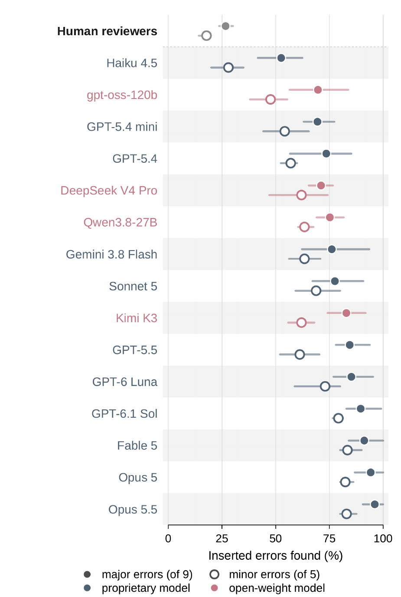
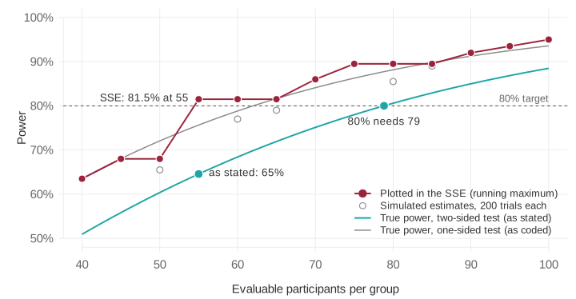
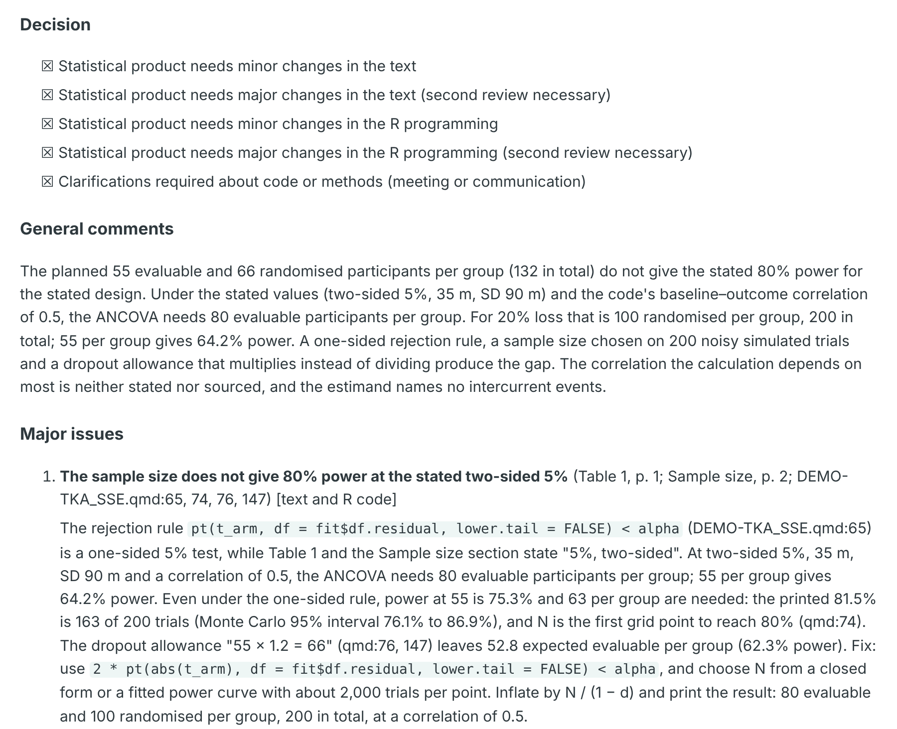

## Should journals ban AI in peer review?

:::: {.columns}
::: {.column width="58%"}
::: compact
Fourteen known errors inserted into reports of randomised trials; every review scored
against the same answer key:
:::

::: {.tight .compact}
- **Human peer reviewers: 27%** of the major errors
- **Each of 15 language models, text only: 53–96%**
- On 58 trials published in 2026: 58–99%
- the models also flagged 14–29% of the error types on unmodified reports
:::

::: {.fragment}
::: {.bigquote .quote-mid}
"For clinical trials, I'd even call human-only review dangerous."
:::

::: attribution
Ruslan Rust, last author, on X
:::
:::
:::

::: {.column width="42%" .fig-tall .fig-motivation}
{fig-alt="Percentage of inserted major and minor errors found per review: human reviewers about 27% of major errors; 15 language models between about 53% and 96%."}
:::
::::

::: {.tiny .muted}
Brian et al., medRxiv, 28 October 2026, not peer reviewed. Humans: 2004 study, 607 reviewers.
Two LLM judges. Fig. 1b, CC BY 4.0.
:::

::: notes
[0:00–1:15] This week's debate: should journals ban AI in peer review? A new preprint
repeated the classic BMJ experiment: errors inserted into trial reports, one answer
key. Human reviewers in 2004 found about a quarter of the major errors; every one of
15 current models, reading only the text, found more, the best almost all. Caveats:
a preprint, a historical human comparison, LLM judges, and models that also flag
concerns on clean reports. The last author's conclusion: for clinical trials,
human-only review is dangerous. Today: how we put this to work on our own statistical
products, before they go out.
:::

## The job: the consistency review

:::: {.columns}
::: {.column width="54%"}
Every DKF statistical product gets a second statistician's review before it goes out:
sample size estimations, protocol statistics sections, analysis plans, reports,
manuscripts.

The review ends in a form:

::: tight
- **Decision**: minor or major changes to text or code; clarification needed
- **General comments**, **major** and **minor issues**
- **Answers** to the questions in the assignment
:::
:::

::: {.column width="46%"}
**Where errors hide**

::: levels
<div><span class="chip text">Text</span> what the PDF says: a wrong formula, a missing
estimand component</div>
<div><span class="chip code">Code</span> what only the source shows: a one-sided test,
a value that never reaches the text</div>
<div><span class="chip comp">Computation</span> what the code actually computes: a stale
number, a figure built on noise</div>
:::
:::
::::

::: notes
[1:15–2:15] The second statistician reads the rendered document against its Quarto
source and the protocol or SAP. Keep the three levels in mind; they come back in the
demo. A reader finds the first, a careful reader of the code the second, and only
someone who runs things finds the third.
:::

## Ten months, four approaches

```{=html}
<div class="timeline">
  <div class="tl">
    <div class="tl-date">Early 2026</div><div class="tl-dot"></div>
    <div class="tl-title">First prompts</div>
    <div class="tl-text">One SSE, four models: Claude Opus 4, GPT-4o, GPT-5 Pro, GPT-5.2 Pro.
    $0.03 to $1.36 per review.</div>
  </div>
  <div class="tl">
    <div class="tl-date">May 2026</div><div class="tl-dot"></div>
    <div class="tl-title">Review prototype</div>
    <div class="tl-text">Quarto document calling two Python SDKs from R: Claude Opus 4.7
    streaming, GPT-5.5 Pro as a background job. Output in the DKF form.</div>
  </div>
  <div class="tl">
    <div class="tl-date">August 2026</div><div class="tl-dot"></div>
    <div class="tl-title">R-first notes</div>
    <div class="tl-text">ellmer and the Anthropic SDK; the prototype as a teaching example.
    Opus 5: $0.68 for a full SSE and its source.</div>
  </div>
  <div class="tl now">
    <div class="tl-date">October 2026</div><div class="tl-dot"></div>
    <div class="tl-title">Agent skills</div>
    <div class="tl-text">Claude Code with four DKF review skills, adapted from open-source
    research skills.</div>
  </div>
</div>
```

::: {.fragment .punchline}
Each step was useful; the last one can finally run the code.
:::

::: notes
[2:15–3:00] A quick tour of what we tried. Every step was useful to us, and each
model generation read more carefully than the last. The costs are from our own run
logs.
:::

## One scripted call: the review prototype

:::: {.columns}
::: {.column width="52%"}
```{=html}
<div class="trio-col" style="margin-top:0.6em">
  <div><span class="node">.qmd source</span> <span class="node">rendered PDF</span>
  <span class="node">reviewer's questions</span></div>
  <div class="down">↓</div>
  <div class="node model" style="font-size:0.75em">one prompt, one model call</div>
  <div class="down">↓</div>
  <div class="node out" style="font-size:0.75em">review in the DKF form</div>
</div>
```
:::

::: {.column width="48%"}
::: tight
- The prompt is a senior reviewer's checklist: validity, numerical consistency,
  code and reproducibility, interpretation
- Every run is logged: model, prompt hash, tokens, cost; nothing is overwritten
- Rendering the report never calls the API
- Minutes per review, under $1.50
:::
:::
::::

::: {.fragment .punchline}
Useful, and still a good quick second pair of eyes.
:::

::: notes
[3:00–3:45] The prototype reads the source and the PDF together and returns the form
we already use. It was cheap and fast, and colleagues found it useful.
:::

## What we learned building it

:::: {.columns}
::: {.column width="50%"}
**What took the effort**

::: {.tight .compact}
- background jobs, polling and streaming
- uploading PDFs; two Python SDKs driven from R
- proving the model read the source to the end
- token counts and cost estimates
:::
:::

::: {.column width="50%"}
**What carried over**

::: {.tight .compact}
- the checklist: what a second statistician checks
- the DKF form as the output
- a record of every run
:::

::: {.small .muted}
Meanwhile, six frontier models came out in ten months: Claude Opus 4, 4.7, 5;
GPT-5 Pro, 5.2 Pro, 5.5 Pro.
:::
:::
::::

::: {.fragment .punchline}
The models improve every few months, and what we know about reviewing carries over.
:::

::: notes
[3:45–4:45] Most of our effort went into code that talks to one provider's interface
at one point in time: background jobs, uploads, two SDKs. (One example: our May code
set temperature to zero; by August current models rejected that setting outright.)
What carried over to every new model was the knowledge of what to check and the form
we want back.
:::

## What one call can and cannot do

:::: {.columns}
::: {.column width="50%"}
**It reads well**

::: {.tight .compact}
- trial reports: every model beat the human reviewers on the inserted errors (first
  slide)
- our Unjournal comparison: one call per paper found **80%** of the issues the expert
  evaluators agreed on, across 12 economics and policy papers
:::
:::

::: {.column width="50%"}
**It cannot check**

::: {.tight .compact}
- run the code
- recompute a printed number
- re-run the simulation behind a figure
- show what it checked and what it only found plausible
:::

::: quote-small
"Every error tested here is visible in the text, whereas errors in data handling or
analysis code […] are not." Brian et al. 2026
:::
:::
::::

::: {.fragment .punchline}
Reading is a strong start. Checking needs the code.
:::

::: notes
[4:45–5:45] Both studies say a single call reads attentively: on trial reports it
beats human reviewers, on economics papers it finds most of what experts agree on.
But it can only read. The preprint's authors say so themselves: their errors were all
visible in the text, and the next gains need access to code, protocols and registry
entries. Everything a reading model says about a number is a guess about that number.
:::

## Others built review pipelines; we built on open skills

::: cards
<div class="card"><div class="card-title">Reviewer 2 (isitcredible.com)</div>
More than 30 chained model calls: aggressive prompting, then a verification cascade
to remove what the aggression invents. 15–45 minutes and a few dollars per paper.</div>
<div class="card"><div class="card-title">Refine (refine.ink)</div>
Referee-style reports on research papers, checking logic, clarity and internal
consistency. About $50 per paper.</div>
:::

::: {.fragment}
::: accent-box
In October, Reviewer 2's author released "the three skills that I use to begin my
reviews, now freely available for anyone to use". Our DKF skills build on them.
:::

::: attribution
Joseph Francis on X, 26 October 2026; github.com/isitcredible/research_skills (MIT)
:::
:::

::: notes
[5:45–6:30] Dedicated review pipelines and services appeared, and some are very good.
We didn't build one. Instead we built on the open skills that Reviewer 2's author
released this October: free, readable, and easy to adapt to our products and our form.
:::

## What changed: an agent with skills

```{=html}
<div class="trio">
  <div class="trio-col">
    <div class="trio-title">One call</div>
    <div class="node">PDF + source</div><div class="down">↓</div>
    <div class="node model">model</div><div class="down">↓</div>
    <div class="node out">review</div>
    <div class="trio-note">reads once</div>
  </div>
  <div class="trio-col">
    <div class="trio-title">Pipeline</div>
    <div class="node">PDF</div><div class="down">↓</div>
    <div class="chain"><span class="node model">call 1</span><span class="sep">→</span><span class="node model">call 2</span><span class="sep">→ … →</span><span class="node model">call 30+</span></div>
    <div class="down">↓</div>
    <div class="node out">review</div>
    <div class="trio-note">fixed steps, written by hand</div>
  </div>
  <div class="trio-col">
    <div class="trio-title">Agent with skills</div>
    <div class="node">job folder + skill</div><div class="down">↓</div>
    <div class="loop"><span class="node model">model</span><span class="sep">⇄</span><span class="node tool">read files · run R · search</span></div>
    <div class="down">↓</div>
    <div class="node out">review + record of every check</div>
    <div class="trio-note">decides its next step; runs the code</div>
  </div>
</div>
```

::: tight
- **Agent**: a general model that uses tools in a loop and chooses its own next step
  (here Claude Code; other coding agents work similarly)
- **Skill**: a folder of plain-text instructions, references and scripts that the
  agent loads when a task matches
:::

::: {.fragment .punchline}
The general part does the work. The skill holds what we know about reviewing.
:::

::: notes
[6:30–7:45] The difference that matters for statisticians is the right-hand column:
the agent can run the code. It reads the source, runs it, recomputes the numbers and
checks them against the text. The skill is text: what to check and how to report it,
not how to talk to an API.
:::

## The DKF review skills

```{=html}
<div class="flow">
  <div class="step"><div class="step-title">Document</div><div class="step-text">versions; protocol, SAP and registry; printed numbers and their arithmetic; design and estimand</div></div>
  <div class="step"><div class="step-title">Code and data</div><div class="step-text">code against text; Quarto and R mechanics; runs the code; 12 clinical modules</div></div>
  <div class="step"><div class="step-title">Statements</div><div class="step-text">what the product claims, one row each, and whether it holds</div></div>
  <div class="step fresh"><div class="step-title">Challenge</div><div class="step-text">a fresh agent tests every finding, in both directions</div></div>
  <div class="step fresh"><div class="step-title">Verdict</div><div class="step-text">a fresh agent writes the result and answers the assignment</div></div>
  <div class="step optional"><div class="step-title">Audit</div><div class="step-text">depth "full": coverage and re-runs, mechanically</div></div>
  <div class="step form"><div class="step-title">Form</div><div class="step-text">the DKF consistency review, Decision boxes computed</div></div>
</div>
```

::: {.small}
**Modules**: sample size, simulation, estimand, RCT, missing data, time-to-event,
multiplicity, regression, observational, prediction, Bayesian, small samples.
**Depth**: quick (no challenge), standard, full (with audit).
:::

::: {.small .muted}
Adapted from Joseph Francis's research_skills (MIT licence), written for economics papers
with replication packages; the clinical modules, the data rules and the form are ours.
:::

::: notes
[7:45–9:00] Five stages and two optional ones. The fresh agents matter: the challenge
and the verdict are written by agents that did not produce the findings, so they have
no stake in them. The modules fire depending on the product; for an SSE, sample size,
simulation, RCT and a light missing-data check.
:::

## Checkable by design, safe by default

:::: {.columns}
::: {.column width="50%"}
**Checkable**

::: {.tight .compact}
- every number traced to a file and line, or to a script and its log
- coverage as a list: every table, figure and code chunk
- a status for every check: settled, untested, unverifiable, not checked here
- the burden is on the product: a planning value with no source is a finding
- a stage is done only when its check script passes
:::
:::

::: {.column width="50%"}
**Safe by default**

::: {.tight .compact}
- data mode set before the run: none (default), synthetic, or shared with a recorded
  clearance
- a scan stops the run when data sits where the mode does not allow it
- synthetic data from the code, or from a codebook made locally
- web searches use general terms only
- no zero-data-retention agreement yet: what is sent is kept under the provider's terms
:::
:::
::::

::: notes
[9:00–10:00] Two things make this usable in a CTU. First, the output can be checked:
nothing is asserted without a trace. Second, patient data stays out unless someone
decided otherwise before the run, and the decision is recorded.
:::

## Demo: a synthetic SSE with six planted issues

:::: {.columns}
::: {.column width="33%" .compact}
**DEMO-TKA** (invented)

App-guided home exercise versus supervised physiotherapy after knee replacement.
Six-minute walk distance at 6 months; ANCOVA; power by simulation. Two pages of
Quarto and R.

::: {.small .muted}
The design of the trial-report benchmark (inserted errors, one answer key), extended
to code and computation.
:::
:::

::: {.column width="67%" .demo-table}
| Level | Planted issue |
|:--|:------------------------------------|
| [Text]{.chip .text} | dropout inflation: 55 × 1.2 instead of 55 / 0.8 |
| [Text]{.chip .text} | estimand without intercurrent events |
| [Code]{.chip .code} | the simulation tests one-sided; the text says two-sided |
| [Code]{.chip .code} | the baseline correlation exists only in the code |
| [Computation]{.chip .comp} | Figure 1 is a running maximum; n chosen on noise |
| [Computation]{.chip .comp} | typed *t*-test number (94) is not what the code computes (105) |
:::
::::

::: notes
[10:00–11:00] We wrote a small SSE with six planted errors, two at each level. Then
we gave it to each approach and scored the reviews against the answer key. The
issues are the kind we see in real products, with invented numbers.
:::

## One figure, two stories

::: figure-wide
{fig-alt="Power by evaluable participants per group. The SSE's plotted curve, a running maximum of 200-trial estimates, crosses 80% at 55 per group. The true power of the two-sided test the SSE states is 64% at 55; 80% needs 80 per group."}
:::

::: {.small}
The SSE reports **81.5% at 55** per group. The true power there is **75%** with the
code's one-sided test and **64%** with the two-sided test the text states. The planning
values support 80 evaluable per group: **200 randomised, not 132**.
:::

::: notes
[11:00–12:15] Wine: what the SSE plotted, a running maximum of noisy estimates. Grey
circles: what was actually simulated where it differs. Mint: the power of the test
the text promises. The design as written has about 62% power. No amount of reading
gets you these numbers; you have to run something.
:::

## Scoreboard

::: score
| Approach | [Text]{.chip .text} of 2 | [Code]{.chip .code} of 2 | [Computation]{.chip .comp} of 2 | Other findings, valid / not | Time | Cost |
|:---|:-:|:-:|:-:|:-:|:-:|:-:|
| Chat | · | · | · | · | · | · |
| Chat + document skill | · | · | · | · | · | · |
| One call (prototype) | · | · | · | · | · | · |
| Agent, standard | 2 | 2 | 2 | 3 / 0 | 3.4 h | $72 |
| Agent, no modules | 2 | 2 | 2 | 1 / 0 | 1.6 h | $27 |
| Agent, quick | 2 | 2 | 2 | 2 / 0 | 0.5 h | $10 |
:::

::: {.small .muted}
Scored against the answer key: an issue counts when the review names the problem and
where it is. Same PDF and source for every run; · not yet run. Time: model time. Cost:
at API list prices; all ran on a subscription.
:::

::: {.fragment .punchline}
The agent found all six, and showed what each one costs in participants.
:::

::: {.fragment .small}
At quick depth: all six in 34 minutes, start to finished form, for about $10.
:::

::: notes
[12:15–13:30] Three agent runs, all six planted issues found every time, two at each
level, each one sized. The first two, at standard depth, took one and a half to three
and a half hours of model time, and days of waiting for usage limits. So we cut the
skills down to size: at quick depth the same review took 34 minutes and about $10,
with a form a third the length. From the first run: at the code's correlation the stated test needs 80
evaluable per group, not 55; the first-crossing rule picks a sample size below 80% true
power in 39% of runs. It added three points a reviewer would accept: where the SD and
the loss come from, missing at random, clustering by physiotherapist. And it caught a
slip in our own key: we had treated the baseline as fixed. Chat, chat with the
document skill (the agent's first stage as a chat skill: the same checklist, no code
run) and one call: fill from demo/runs/scoreboard.csv. If reading finds the code issues but cannot size the
computation ones, close with: the question is not which model is smarter, but which
approach can run the code.
:::

## What the reviewer gets

:::: {.columns}
::: {.column width="40%"}
::: {.tight .compact}
- the DKF form, with the Decision boxes computed from the issues
- each issue with where it is (page, file and line), its numbers and a fix
- answers to the questions in the assignment
- what the review could not check, and why
- `REVIEW` comments in a copy of the `.qmd`
- behind it, the script and log for every number
:::
:::

::: {.column width="60%" .screenshot}
{fig-alt="Excerpt of the quick demo run's consistency review: all five Decision boxes ticked; general comments saying the planned 55 evaluable and 66 randomised participants per group do not give the stated 80% power, and that the ANCOVA needs 80 evaluable and 100 randomised per group; the first major issue, on the one-sided rejection rule, the noisy choice of N and the dropout allowance, with code lines and fixes."}

::: {.tiny .muted}
The quick run's form, excerpt: 3 major and 3 minor issues, about 1,100 words.
:::
:::
::::

::: notes
[13:30–14:15] The deliverable is a draft of the form the second statistician fills in
anyway. Here every Decision box is ticked, and the general comments lead with the
sample size the document does not establish. They read it, check what they doubt,
edit, and sign.
:::

## Where to start

::: tight
1. **Chat, on non-sensitive material.** Explain unfamiliar code, check a paragraph
   against its table, draft questions for a SAP.
2. **A review skill in chat, on a non-sensitive document.** Upload the document check
   as a skill: you read what the agent is told to do, and get tables and a check log,
   not free text.
3. **An agent with review skills for a full pre-review.** It runs the code, recomputes
   and leaves a record; no patient data by default.
4. **A few test cases with known answers.** Plant errors in your own kind of document
   and see which approach finds them.
:::

::: {.fragment .punchline}
Errors found while they are still cheap to fix: before the protocol, not after the
trial.
:::

::: notes
[14:15–15:15] What you can do on Monday. Each step is useful on its own; start with
the first and move on as your data rules allow. The skill in chat is the agent's
first stage on its own: the easiest way to see what the agents do before running one. The aim is better research: errors
found while they are still cheap to fix.
:::

## A closing thought: the bitter lesson

::: bigquote
The biggest lesson that can be read from 70 years of AI research is that general
methods that leverage computation are ultimately the most effective, and by a large
margin.
:::

::: attribution
Rich Sutton, *The Bitter Lesson*, 13 March 2019
:::

::: {.fragment}
::: {.tight .compact}
- Review tools turn over in months: Reviewer 2's author retired his pipeline in October
  ("I decided it was obsolete"), and Claude Science now has a built-in reviewer that
  checks claims against what actually ran
- Our prototype went the same way, and our skills will too: they are plain text, cheap
  to change
:::
:::

::: {.fragment .punchline}
The good news: every new model makes the same checklist more powerful.
:::

::: notes
[15:15–16:30] Sutton wrote about AI research, but the lesson fits our small story:
hand-built machinery keeps losing to general methods that use more computation. Our
prototype, Reviewer 2, probably our skills too, all turn over in months. That is good
news for statisticians. We don't need to build tools; we need to know what to check,
and every new model applies that knowledge better.
:::

## What to invest in

::: tight
1. **Test cases with known answers.** Like the trial-report benchmark or this SSE:
   they show which tool works for us, and when a new one works better.
2. **Standards for the review itself.** Traceable numbers, a status for every check,
   the form.
3. **Rules for data.** What may be sent where, decided before the run.
4. **The statistician who signs.** The output is a draft; the responsibility stays
   with the reviewer.
:::

::: {.fragment .punchline}
Proposal: a shared set of planted-issue SSEs and SAPs across Swiss CTUs.
:::

::: notes
[16:30–17:45] If the tools change every few months, invest in what carries over.
Test cases are the most useful: we can each write two or three, and every new tool
gets scored on the same set. That is something the SCTO platforms could host.
:::

## Thank you

:::: {.columns}
::: {.column width="55%"}
::: {.small .tight}
- Brian et al. 2026: doi.org/10.64898/2026.10.25.26366455
- *The Bitter Lesson*: incompleteideas.net/IncIdeas/BitterLesson.html
- research_skills: github.com/isitcredible/research_skills
- Reviewer 2: github.com/isitcredible/reviewer2
- Refine: refine.ink
- LLM versus human evaluations: llm-uj-research-eval.netlify.app
:::
:::

::: {.column width="45%"}
Questions, and offers of test cases, welcome.

::: {.small .muted}
The demo SSE and its answer key, the document check for chat and these slides are
available on request.
:::
:::
::::

::: notes
[17:45–20:00] Questions.
:::

# Backup {.divider}

## Early runs on one SSE, January–February 2026

| Model | Runs | Cost per review |
|:------|:----:|:---------------:|
| Claude Opus 4 | 5 | $0.49 |
| GPT-4o | 1 | $0.03 |
| GPT-5.2 Pro | 1 | $0.76 |
| GPT-5 Pro | 1 | $1.36 |

::: {.small .muted}
Same document and reviewer question; costs from the run logs.
:::

## The prototype's prompt (abridged)

```text
You are a senior biostatistics reviewer performing pre-human quality review
for a clinical research document. Review the available material: PDF, Quarto
source, or both.

Check:
1. Statistical validity: design, estimand, endpoint, model, assumptions,
   missing data, multiplicity, sensitivities.
2. Numerical consistency: Ns, denominators, percentages, p-values, CIs,
   tables, figures, and text.
3. Code/reproducibility: filters, joins, grouping, NA handling, seeds,
   hard-coded paths, package/version fragility.
4. Interpretation: overclaiming, unsupported causal language.

Anchor each issue to a page, section, table, figure, chunk label, or code
fragment. Mark what is verified vs suspected.
Output: Decision · General Comments · Major Issues · Minor Issues · Answers
```

## Inside a review job

```text
jobs/2026-11_DEMO-TKA/
├── 00_ASSIGNMENT.md     product type, questions, data mode, depth, clearances
├── 00_INTAKE.md         what was received; requests for the operator
├── PROGRESS.md          done, running, next: a stopped run resumes here
├── 01_product/          the .qmd and the rendered PDF
├── 02_governing/        protocol, SAP, registry entry
├── review/              stage reports, extracts, intake scan
├── analysis/            consistency matrix, spec map, statement ledger, results
├── work/                scripts and logs of every re-run
├── SYNTHESIS.md         the verdict
├── ISSUES.md            the issue ledger the form is built from
└── CONSISTENCY_REVIEW.html   the draft form
```

::: {.small .muted}
Job folders are never committed. A stage counts as done only when its check script
passes.
:::

## One finding, traced: 80 per group, not 79

:::: {.columns}
::: {.column width="56%"}
**The review says**

::: quote-small
"At a correlation of 0.5 the planned ANCOVA needs 80 evaluable and 100 randomised
participants per group (200 in total) under the stated two-sided test"
:::

**Its evidence**

::: {.tight .small}
- exact power with a random baseline: 79.83% at 79, 80.34% at 80
  (`work/logs/ss_exact_ancova.log`)
- rebuilt by the challenge agent (`work/challenge/s1_N_exact.log`)
- the SSE's own simulation, made two-sided, 10,000 trials per point: 80% crossed at
  78.5 and 79.2 (`work/challenge/s5_N_sim.log`)
:::
:::

::: {.column width="44%"}
**Our answer key said 79**

::: {.tight .small}
- it treated the baseline as fixed; the SSE draws it at random
- the chance baseline difference between the arms costs about half a participant per
  group
- recomputed with a random baseline: 79.8% at 79, 80.3% at 80
:::

::: {.fragment .punchline}
The agent was right; we corrected the key.
:::
:::
::::

## Data modes

| Data mode | The agent reads | What the review can establish |
|:--|:--|:--|
| `none` (default) | documents and code | everything that needs no patient data: sample size and simulation code, arithmetic on printed numbers, code against text |
| `synthetic` | + dummy data, built from the code or from a codebook made locally | that the code runs and does what the text says; never a printed result |
| `shared` | + patient-level data, only with a recorded clearance | reproduction of printed results |

## Running on a subscription

::: tight
- The skills run inside Claude Code, so a review counts against a subscription's
  usage limits rather than API credits, as long as no API key is set in the
  environment (check `/status`)
- The demo review at standard depth: about 15 agents, 3.4 hours of model time, about
  $72 at API list prices, two waits for the 5-hour limit
- At depth `quick` (skills 0.2): 3 agents, 34 minutes start to finished form, about
  $10 at API list prices
- Depth `quick` for routine SSEs; a stopped run resumes from its progress file
- Data terms depend on the plan: on personal plans, model training on your sessions
  is a privacy setting; commercial plans and the API are not covered by it
:::

## The answer key in numbers

| | As written | Correct |
|:--|:--:|:--:|
| Test in the simulation | one-sided 5% | two-sided 5% |
| Power at 55 per group | 81.5% (200 trials, running max) | 64% (exact 64.2%; 64.3% in 20,000 trials) |
| Evaluable per group for 80% | 55 | 80 |
| Dropout inflation | 55 × 1.2 = 66 | 80 / 0.8 = 100 |
| Randomised in total | 132 | 200 |
| Unadjusted *t*-test, per group | 94 (typed) | 105 |
| Baseline correlation | 0.5, code only | stated and sourced |

::: {.small .muted}
All values from `demo/answer-key.R`; exact power with the baseline random, as the SSE
simulates it.
:::
