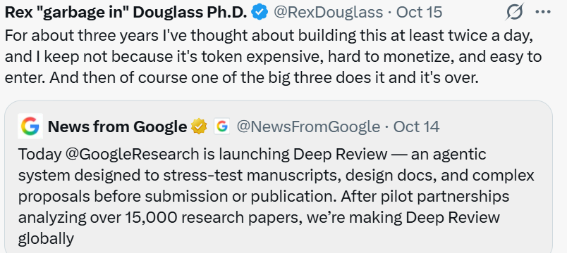

## Models find more errors than reviewers did

:::: {.columns}
::: {.column width="56%"}
```{=html}
<div class="shot"></div>
```

::: {.fragment fragment-index=1 .punchline}
Human reviewers found 27% of the major errors; each of 15 models found more, 53 to 96%.
:::
:::

::: {.column width="44%" .plate .fragment fragment-index=1}
{fig-alt="Percentage of inserted major and minor errors found per review: human reviewers about 27% of major errors; 15 language models between about 53% and 96%."}

::: {.tiny .muted}
Brian et al., medRxiv 2026, Fig. 1b (CC BY 4.0)
:::
:::
::::

```{=html}
<div class="pop fragment" data-fragment-index="2"></div>
```

::: notes
[0:30–1:45] The debate this autumn: should journals ban AI in peer review? Ruslan Rust's
group tested it. His conclusion: from now on he won't review without AI, and for
clinical trials he calls human-only review dangerous. [click] They repeated the classic
BMJ experiment: known errors inserted into reports of randomised trials, every review
scored against the same answer key. Human peer reviewers, in the 2004 study, found
about a quarter of the major errors. Every one of 15 current models, reading only the
text, found more: 53 to 96%. Caveats: a preprint, a historical human comparison,
language models as judges, and models that also flag concerns on clean reports.
[click] A second study, from Harvard, the same week: King and Worthington compared AI
reviews with paid human reviews that editors and authors had rated unusually good, and
the AI reviews were better by every measure they could construct: 124 papers, one review
each from Claude Opus 4.8 at its maximum reasoning setting, judged by another model and
by three former journal editors, who preferred the AI review in 26 of 30 judgments.
Also a working paper. Or as one researcher put it: "It's been true for a year at least."
:::

## And our internal review?

::: big
Sample size estimations, analysis plans, reports
:::



::: notes
[1:45–2:15] Journals are one thing. What can these tools do, more specifically, for our
own review: the consistency review of sample size estimations, analysis plans and
reports, where a second statistician checks the methods, the numbers and the code? [click]
Where does AI come in? I have tried a few things, and I'll show them, so that we can discuss this with some
experience rather than in the abstract. All of it is my own exploration, not something
DKF runs or recommends.
:::

## Four ways I explored



::: notes
[2:15–2:45] Four ways. The chat: paste and ask. [click] Review services: someone else's
pipeline. [click] Your own pipeline, a script through the API. [click] And then
something different: an agent that runs the code in the repository.
:::

## Paste it into the chat

::: crumbs
<span class="on">Chat</span><span>Services</span><span>Script</span><span>Agent</span>
:::

::: big
Strongest model, maximum effort
:::



::: notes
[2:45–3:45] The simplest way is what the preprint tested. Paste the PDF and the source
into a chat and ask it to check whether the document is consistent. [click] Take the
strongest model, GPT Pro or Claude Fable or Opus, and set its effort to maximum.
[click] You get an answer, and it works surprisingly well; in my experience since
OpenAI's o1 pro, in December 2024. King and Worthington's AI reviews were made exactly
this way: one model at its maximum reasoning setting, given the paper and the
reviewer guidelines. What you don't get: a record of what was checked, the same answer
twice, or better data terms than your plan's. [click] You can also give the chat your
own checklist, as a skill: a folder with instructions and small scripts, which the
model loads when the task matches. Mine, dkf-document-check, is the first stage of my
review skills: it names the design and the estimand attribute by attribute, recomputes
every printed number and logs each check. It is adapted from the skills released by Joe
Francis (research_skills, MIT licence).
:::

## What's in a skill

::: crumbs
<span class="on">Chat</span><span>Services</span><span>Script</span><span>Agent</span>
:::



::: notes
[3:45–4:30] What a skill is, concretely: a folder. Mine for the chat is called
dkf-document-check. The model always sees only its name and description, which says
when to use it: when asked to check, review or consistency-review a statistical
document. [click] When a task matches, it reads SKILL.md, the checklist: the rules,
then three checks in order: the documents, their versions and their consistency with
protocol and SAP; the printed numbers and their arithmetic; and the design, the estimand
and the method; then what the output looks like. [click] And it opens the rest only when
needed: references on estimands, clinical guidelines and the kinds of product, and a
script that recomputes the printed numbers. Plain text and a small script, adapted from
the skills Joe Francis released; the agent's skills are built the same way.
:::

## Review services

::: crumbs
<span>Chat</span><span class="on">Services</span><span>Script</span><span>Agent</span>
:::



```{=html}
<div class="svc fragment" data-fragment-index="3">
  <div><div class="n"><a href="https://refine.ink">refine.ink</a></div><div class="t">paid, up to $50</div></div>
  <div><div class="n"><a href="https://reviewer3.com">reviewer3.com</a></div><div class="t">paid</div></div>
  <div><div class="n"><a href="https://paperreview.ai">paperreview.ai</a></div><div class="t">free · Stanford</div></div>
  <div><div class="n"><a href="https://openaireview.org">openaireview.org</a></div><div class="t">free · Chicago</div></div>
  <div><div class="n"><a href="https://github.com/isitcredible/reviewer2">Reviewer 2</a></div><div class="t open">open source · Joe Francis</div></div>
  <div><div class="n"><a href="https://coarse.ink">coarse.ink</a></div><div class="t open">open source</div></div>
  <div><div class="n"><a href="https://research.google/blog/analyzing-technical-documents-with-deep-review/">Deep Review</a></div><div class="t">free, 2 a week · Google</div></div>
  <div class="more"><div class="n">…</div><div class="t">more every month</div></div>
</div>
```

::: notes
[4:30–5:30] Others have built whole review pipelines and offer them as services. You
upload the PDF. [click] Behind it run fixed chains of model calls, with prompts the
vendor wrote; Reviewer 2's first stage, The Breaker, takes a sledgehammer to the text,
and later stages filter out what the aggression invents. [click] You get a report.
[click] There are more every month: Refine and Reviewer3 are paid, Refine up to fifty
dollars a paper; paperreview.ai from Stanford and openaireview from Chicago are free; Joe
Francis's Reviewer 2 and coarse.ink are open source; and in October Google launched Deep
Review, free for two reviews a week. All built for research papers, and you upload to a
third party. Or you build your own.
:::

## Your own script

::: crumbs
<span>Chat</span><span>Services</span><span class="on">Script</span><span>Agent</span>
:::



::: notes
[5:30–6:30] Your own pipeline: a script through the API, for many documents. [click] The
script, in R with the ellmer package or in Python with the providers' SDK libraries,
sends each document with the same system prompt; mine reads like a senior reviewer's
checklist, the statistical methods first, then the numbers, the code and the
interpretation. [click] The model answers, and you pay per use. [click] You collect a
table, one row per document, with a log of every run: model, tokens, cost. My review
prototype did this for our SSEs for under a dollar fifty. You also get the API's
commercial data terms. [click] And that is the real reason to script it: you can test
it. Run the same script on test cases with known answers and score every run; in R, the
vitals package does this next to ellmer, a port of Inspect, the Python framework for
evaluating language models. So you compare prompts, models and effort settings on cases
you know. The price is code that talks to one provider at one point in time.
:::

## An agent in the repository

::: crumbs
<span>Chat</span><span>Services</span><span>Script</span><span class="on">Agent</span>
:::



::: notes
[6:30–8:00] The last step: an agent working in the product's repository, here Claude
Code on the web. The skills come back as its instructions: what you type is one
sentence, "review the product with dkf-review, then write the consistency review"; the
skills hold the rest. It runs in an isolated cloud machine, with a copy of the
repository and the skills. [click] It has tools: read files, run the R code, write logs.
[click] Claude, the model, decides the next step; the tools carry it out, and the result
comes back. [click] Again and again, until it is done. So it does what no reader can: it
runs the code, recomputes the numbers and re-runs the simulations, and agents that did
not write a finding challenge it. [click] The output is a draft of the
consistency-review form with a log behind every number, pushed to a branch. [click] And
it never touches your computer. It runs on your Claude subscription, no API credits.
What it reads still goes to the provider, under your plan's terms. [click] And the same
agent can be started from a script, with the Agent SDK in Python or TypeScript, or with
claude -p from R: to run it over test cases with known answers, for batch runs, with
guardrails in code. That runs on an API key, billed per token; for one review you don't
need it (appendix).
:::

## The agent: what you choose

::: crumbs
<span>Chat</span><span>Services</span><span>Script</span><span class="on">Agent</span>
:::

::: scope
In the job's assignment, with the product, its protocol and SAP, and your questions:
:::

```{=html}
<div class="opts">
  <div>
    <div class="h">Depth</div>
    <div class="o"><span class="k">quick</span>two agents, for a short SSE</div>
    <div class="o"><span class="k">standard</span>an agent per stage, and a challenge</div>
    <div class="o"><span class="k">full</span>adds an audit</div>
  </div>
  <div class="fragment" data-fragment-index="1">
    <div class="h">Data</div>
    <div class="o"><span class="k">none</span>documents and code</div>
    <div class="o"><span class="k">synthetic</span>dummy data, so the code runs</div>
    <div class="o"><span class="k">shared</span>patient data, with a clearance</div>
  </div>
  <div class="fragment" data-fragment-index="2">
    <div class="h">You get</div>
    <div class="o"><span class="k">the form</span>the DKF consistency review</div>
    <div class="o"><span class="k">comments</span>in a copy of the .qmd</div>
    <div class="o"><span class="k">logs</span>behind every number</div>
  </div>
</div>
```

::: {.fragment fragment-index=3 .scope}
Twelve clinical modules: sample size, simulation, estimand, RCT, missing data,
time-to-event, multiplicity, regression, observational, prediction, Bayesian, small
samples.
:::

::: notes
[8:00–9:00] What you choose for the agent, in the job's assignment file, next to the
product, the documents it depends on, such as the protocol and the SAP, and your
questions to the reviewer. The depth: quick is two agents, for a short SSE or a
re-review; on the demo it took 34 minutes. Standard is one agent per stage, and a fresh
agent challenges every finding. Full adds an audit, for high-risk products. [click] The
data: by default none, only documents and code. Synthetic: the agent builds dummy data
from the code's data contract, or from a codebook you make locally, so the code runs
without patient data; that shows that the code runs and does what the text says, and
that its estimators recover known effects, but never a printed number. Shared:
patient-level data, only with a recorded clearance. [click] What you get: the DKF
consistency-review form with the decision boxes filled in, REVIEW comments in a copy of
the Quarto source, and a log behind every number. [click] And twelve clinical modules
come in when the product needs them.
:::

## Try it yourself

:::: {.columns}
::: {.column width="47%"}
::: punchline
Your own script
:::

::: where
scto-ai-review · tools/3-api
:::

```bash
Rscript review.R product.pdf
python review.py product.pdf
```

::: {.tight .compact}
- the same prompt for every product
- a table of issues, a log of tokens and cost
- an API key, paid per use
:::
:::

::: {.column width="6%"}
:::

::: {.column width="47%" .fragment fragment-index=1}
::: punchline
The agent
:::

::: where
stats_review · tag skills-v0.3.1
:::

```text
Review the product with dkf-review,
then write the consistency review.
```

::: {.tight .compact}
- claude.ai/code, on your plan
- with your repository and stats_review
- setup: tools/web_setup.sh
- the review lands on a branch
:::
:::
::::

::: {.fragment fragment-index=2 .scope}
**github.com/valentinklotzbuecher/scto-ai-review**: the kit, a handout, a test case\
**github.com/valentinklotzbuecher/stats_review**: the review skills
:::

::: notes
[9:00–9:45] And you can try both. The script is in the kit, the repository
scto-ai-review, in the folder tools/3-api: the R or the Python starter sends a product
through the API with my prompt and answer format. One command, and you get a table of
issues and a log of tokens and cost; you need an API key, paid per use. Run it on the
demo first: a two-page sample size estimation with six planted issues and an answer
key, so you can score what it finds. [click] The agent: Claude Code on the web, at
claude.ai/code, on your Claude plan. You start a session with your product's repository
and stats_review, the repository with my review skills, at the tag skills-v0.3.1; its
setup script, tools/web_setup.sh, installs R and Quarto in the cloud machine. You type
one sentence, and the review lands on a branch of your product's repository, where you
merge it. [click] Both repositories, with a handout that walks through each step.
:::

## To discuss

::: {.tight}
- What would you need to see before you sign a product an AI reviewed?
- Review results, not lines?
- Which checks stay with us: the estimand, the design?
- Should we write our products for an AI reader?
- A replication certificate with every product?
- Build our own tools, or wait for the next model?
- How will junior statisticians learn to review?
:::

::: notes
[9:45–20:00] To discuss. What would you need to see before you sign a product an AI
reviewed? Could our review become result-oriented: the AI goes through every line,
every number and every re-run, and we check that it tested enough, that each chunk,
section and analysis does what it says, and that the approach and the interpretation
hold? Even the author of the skills I build on says the results come from robots and
should be verified by humans. Which checks stay with us: the choice of estimand, the
clinical relevance, the design? If an AI reads our products first, should we write them
for it: the estimand in full, every assumption in the text and not only in the code,
every number traceable to the code that makes it? Certify, from Gary King, Yiqing Xu and
Leo Yang at Harvard, has your own AI assistant, Claude Code or Codex, rerun a
replication package on your computer, and certifies that rerunning the code produces
the results to be published: should our products carry such a certificate? Should we
build our own tools at all? Sutton's bitter lesson: hand-built machinery keeps losing to
general methods that use more computation. Rex Douglass, on the day Google launched Deep
Review, said he never built a review tool because "one of the big three does it and
it's over"; Joe Francis retired Reviewer 2 as obsolete; my own prototype went the same
way, and my skills will too. What carries over: test cases with known answers, review
standards, data rules (backup slide in the appendix). And how will junior statisticians
learn to review, if the AI does the line-by-line work? The preprint's last author calls
human-only review dangerous for clinical trials; is AI-only review? Thank you; the
links are in the appendix.
:::

# Appendix {.divider}

## The bitter lesson

::: quote
"… general methods that leverage computation are ultimately the most effective, and by
a large margin."
:::

::: attribution
Rich Sutton, The Bitter Lesson, 2019
:::

```{=html}
<div class="pop fragment fade-in-then-out" data-fragment-index="1"></div>
<div class="pop fragment fade-in-then-out" data-fragment-index="2"></div>
```

::: {.fragment fragment-index=3}
::: {.tight}
- What carries over: test cases with known answers, review standards, data rules
:::
:::

::: notes
Backup for "Build our own tools, or wait for the next model?". Sutton's lesson from 70 years of AI
research: hand-built machinery keeps losing to general methods that use more
computation, and review tools are no exception. [click] Rex Douglass, on the day Google
launched Deep Review: he had thought about building a review tool twice a day for three
years, and didn't, because "one of the big three does it and it's over". [click] Later
that month Joe Francis retired Reviewer 2: he decided it was obsolete, and he now begins
his reviews with skills. My own prototype went the same way, and my skills will too:
tools are obsolete before they are finished. [click] What carries over to every new
model: test cases with known answers, standards for what a review must check, and rules
for what data may go where.
:::

## The Agent SDK

- Claude Code as a library (Python, TypeScript): the same tools, agent loop and skills
- Worth it for evals over many test cases, batch runs, and hard guardrails in code
- Not needed for one review; it does not fine-tune the model
- Runs on an API key, billed per token, unlike Claude Code on a subscription
- From R, the command-line `claude -p` does the same

## Links

::: {.small .tight}
- This talk, with a handout, R and Python starters and the demo: [github.com/valentinklotzbuecher/scto-ai-review](https://github.com/valentinklotzbuecher/scto-ai-review); the review skills: [github.com/valentinklotzbuecher/stats_review](https://github.com/valentinklotzbuecher/stats_review/tree/skills-v0.3.1)
- Brian et al., medRxiv 2026: [doi.org/10.64898/2026.10.25.26366455](https://doi.org/10.64898/2026.10.25.26366455)
- King and Worthington, working paper 2026: [gking.harvard.edu/peerless](https://gking.harvard.edu/peerless/)
- Services: [refine.ink](https://refine.ink), [reviewer3.com](https://reviewer3.com), [paperreview.ai](https://paperreview.ai), [openaireview.org](https://openaireview.org), [coarse.ink](https://coarse.ink), Google's [Deep Review](https://research.google/blog/analyzing-technical-documents-with-deep-review/)
- Certify, replication certificates run by your own AI assistant (King, Xu and Yang, Harvard): [certify.iq.harvard.edu](https://certify.iq.harvard.edu/)
- Reviewer 2: [github.com/isitcredible/reviewer2](https://github.com/isitcredible/reviewer2); research_skills: [github.com/isitcredible/research_skills](https://github.com/isitcredible/research_skills)
- Claude Code on the web: [code.claude.com/docs/en/claude-code-on-the-web](https://code.claude.com/docs/en/claude-code-on-the-web)
- Agent SDK: [code.claude.com/docs/en/agent-sdk](https://code.claude.com/docs/en/agent-sdk/overview)
- ellmer and vitals: [ellmer.tidyverse.org](https://ellmer.tidyverse.org), [vitals.tidyverse.org](https://vitals.tidyverse.org)
- Rich Sutton, The Bitter Lesson: [incompleteideas.net/IncIdeas/BitterLesson.html](http://www.incompleteideas.net/IncIdeas/BitterLesson.html)
:::
